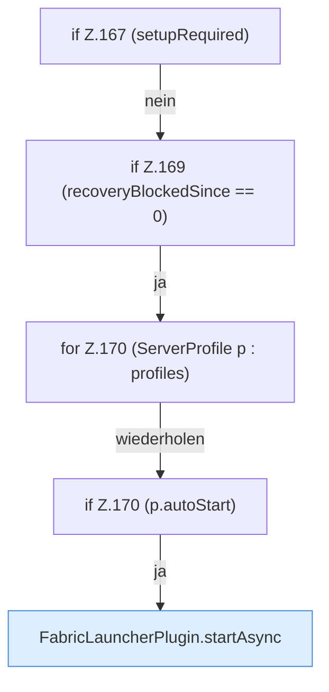

[[00 Start]] › [[Plugin-Kern]] › [[Lebenszyklus]] › [[FabricLauncherPlugin.onEnable]] › [[FabricLauncherPlugin.onEnable.Teil5.Z162.Z165.Z167]]

# FabricLauncherPlugin.onEnable.Teil5.Z162.Z165.Z167

- Fortsetzung von `FabricLauncherPlugin.onEnable.Teil5.Z162.Z165`, Quellreihenfolge.
