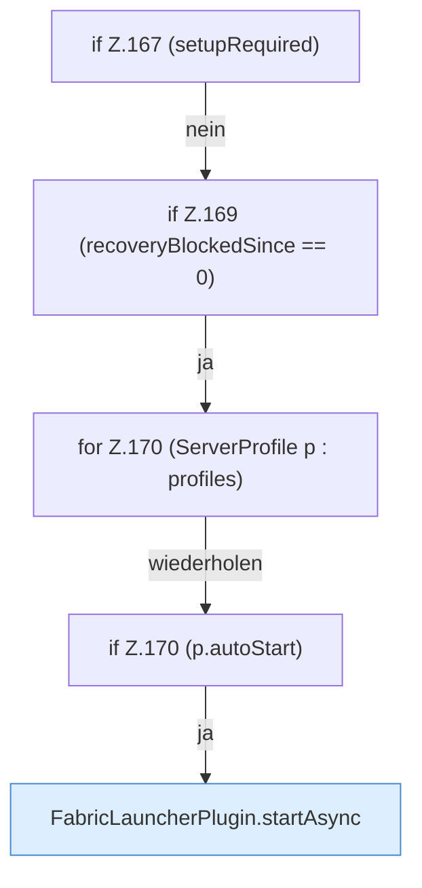

[[00 Start]] › [[Plugin-Kern]] › [[Lebenszyklus]] › [[FabricLauncherPlugin.onEnable]] › [[FabricLauncherPlugin.onEnable.Teil5.Z162.Z165.Z167]]

# FabricLauncherPlugin.onEnable.Teil5.Z162.Z165.Z167



```knoten
if Z.167 (setupRequired)
  Zeile 167: prüft `(setupRequired)`.
if Z.169 (recoveryBlockedSince == 0)
  Zeile 169: prüft `(recoveryBlockedSince == 0)`.
for Z.170 (ServerProfile p : profiles)
  Zeile 170: Schleife `(ServerProfile p : profiles)`.
if Z.170 (p.autoStart)
  Zeile 170: prüft `(p.autoStart)`.
FabricLauncherPlugin.startAsync
  Startet `startAsync`. Ruft `msg`, `slot`, `invalidateRestarts`.
```

- Fortsetzung von `FabricLauncherPlugin.onEnable.Teil5.Z162.Z165`, Quellreihenfolge.
