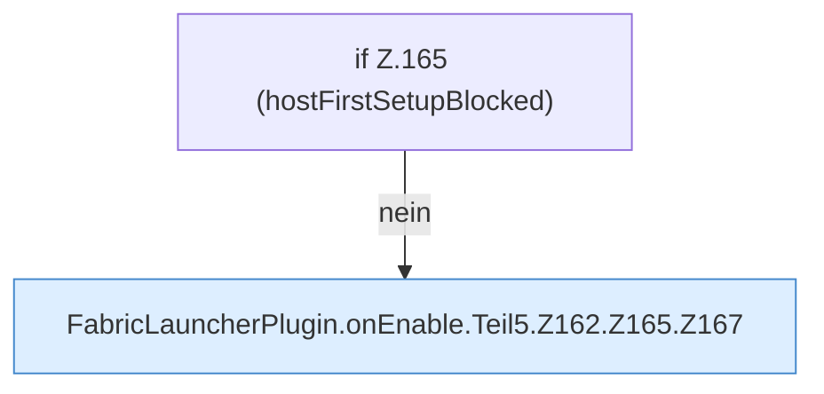

[[00 Start]] › [[Plugin-Kern]] › [[Lebenszyklus]] › [[FabricLauncherPlugin.onEnable]] › [[FabricLauncherPlugin.onEnable.Teil5.Z162.Z165]]

# FabricLauncherPlugin.onEnable.Teil5.Z162.Z165



```knoten
if Z.165 (hostFirstSetupBlocked)
  Zeile 165: prüft `(hostFirstSetupBlocked)`.
FabricLauncherPlugin.onEnable.Teil5.Z162.Z165.Z167
  Fortsetzung des Ablaufs ab Zeile 167.
```

- Fortsetzung von `FabricLauncherPlugin.onEnable.Teil5.Z162`, Quellreihenfolge.
