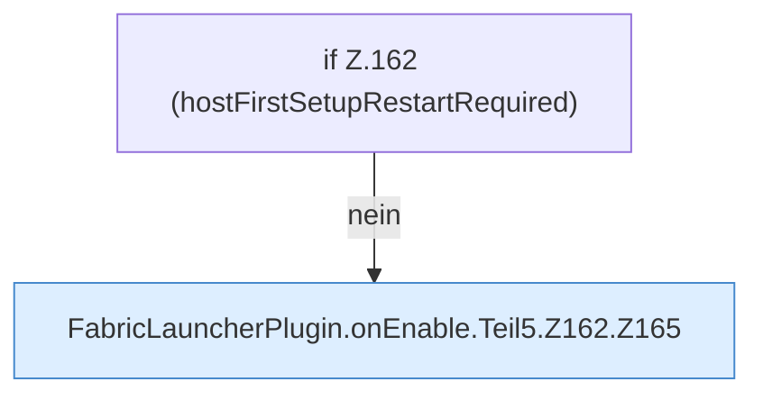

[[00 Start]] › [[Plugin-Kern]] › [[Lebenszyklus]] › [[FabricLauncherPlugin.onEnable]] › [[FabricLauncherPlugin.onEnable.Teil5.Z162]]

# FabricLauncherPlugin.onEnable.Teil5.Z162



```knoten
if Z.162 (hostFirstSetupRestartRequired)
  Zeile 162: prüft `(hostFirstSetupRestartRequired)`.
FabricLauncherPlugin.onEnable.Teil5.Z162.Z165
  Der Ablauf geht in [[Glossar#Zeile|Zeile]] 165 weiter. Eine Ebene tiefer steht er genauer. Fortsetzung des Ablaufs ab Zeile 165.
```

> [!knoten]- Was die Blöcke tun
> - **if Z.162 (hostFirstSetupRestartRequired)**: Zeile 162: prüft `(hostFirstSetupRestartRequired)`.
> - **FabricLauncherPlugin.onEnable.Teil5.Z162.Z165**: Der Ablauf geht in [[Glossar#Zeile|Zeile]] 165 weiter. Eine Ebene tiefer steht er genauer. Fortsetzung des Ablaufs ab Zeile 165.

- Der Ablauf geht in [[Glossar#Zeile|Zeile]] 162 weiter. Eine Ebene tiefer steht er genauer.
- Fortsetzung von `FabricLauncherPlugin.onEnable.Teil5`.
