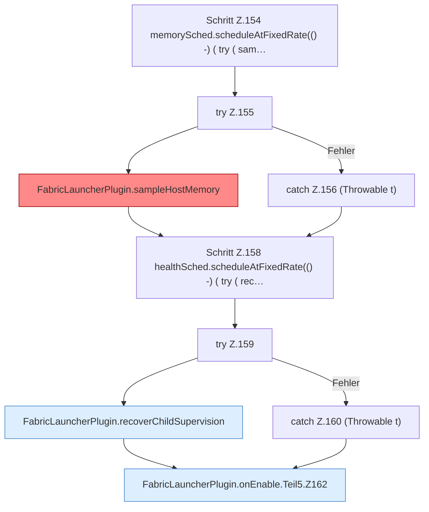

[[00 Start]] › [[Plugin-Kern]] › [[Lebenszyklus]] › [[FabricLauncherPlugin.onEnable]] › [[FabricLauncherPlugin.onEnable.Teil5]]

# FabricLauncherPlugin.onEnable.Teil5



```knoten
Schritt Z.154 memorySched.scheduleAtFixedRate(() -) ( try ( sam…
  Zeile 154: startet einen festen Timer. `memorySched.scheduleAtFixedRate(() -) ( try ( sam…`
try Z.155
  Zeile 155: Versuch. Der Fehlerpfad geht in catch.
FabricLauncherPlugin.sampleHostMemory
  Misst einmal den [[Glossar#Arbeitsspeicher|Arbeitsspeicher]] des [[Glossar#Host|Host]] und entscheidet, ob der [[Glossar#Spielserver|Spielserver]] wegen Mangels aus muss. Ein Sample auf `ServerhosterPlugin-Memory`. [[Glossar#Befund|Befund]]: [[Glossar#Altlast|Altlast]], sicher. Z.1030–1031 liest memoryProtection.autoShutdown als Fallback
catch Z.156 (Throwable t)
  Zeile 156: fängt (Throwable t).
Schritt Z.158 healthSched.scheduleAtFixedRate(() -) ( try ( rec…
  Zeile 158: startet einen festen Timer. `healthSched.scheduleAtFixedRate(() -) ( try ( rec…`
try Z.159
  Zeile 159: Versuch. Der Fehlerpfad geht in catch.
FabricLauncherPlugin.recoverChildSupervision
  Ein [[Glossar#Wecker|Wecker]] alle fünf Sekunden. Er hebt Zustände auf, die hängen geblieben sind, zum Beispiel „startet“, obwohl nichts mehr läuft. Hebt hängende Zustände auf `recoverChildSupervision`. Ruft `assess`, `armWatch`, `armPipe`.
catch Z.160 (Throwable t)
  Zeile 160: fängt (Throwable t).
FabricLauncherPlugin.onEnable.Teil5.Z162
  Der Ablauf geht in [[Glossar#Zeile|Zeile]] 162 weiter. Eine Ebene tiefer steht er genauer. Fortsetzung des Ablaufs ab Zeile 162.
```

> [!knoten]- Was die Blöcke tun
> - **Schritt Z.154 memorySched.scheduleAtFixedRate(() -) ( try ( sam…**: Zeile 154: startet einen festen Timer. `memorySched.scheduleAtFixedRate(() -) ( try ( sam…`
> - **try Z.155**: Zeile 155: Versuch. Der Fehlerpfad geht in catch.
> - **FabricLauncherPlugin.sampleHostMemory**: Misst einmal den [[Glossar#Arbeitsspeicher|Arbeitsspeicher]] des [[Glossar#Host|Host]] und entscheidet, ob der [[Glossar#Spielserver|Spielserver]] wegen Mangels aus muss. Ein Sample auf `ServerhosterPlugin-Memory`. [[Glossar#Befund|Befund]]: [[Glossar#Altlast|Altlast]], sicher. Z.1030–1031 liest memoryProtection.autoShutdown als Fallback
> - **catch Z.156 (Throwable t)**: Zeile 156: fängt (Throwable t).
> - **Schritt Z.158 healthSched.scheduleAtFixedRate(() -) ( try ( rec…**: Zeile 158: startet einen festen Timer. `healthSched.scheduleAtFixedRate(() -) ( try ( rec…`
> - **try Z.159**: Zeile 159: Versuch. Der Fehlerpfad geht in catch.
> - **FabricLauncherPlugin.recoverChildSupervision**: Ein [[Glossar#Wecker|Wecker]] alle fünf Sekunden. Er hebt Zustände auf, die hängen geblieben sind, zum Beispiel „startet“, obwohl nichts mehr läuft. Hebt hängende Zustände auf `recoverChildSupervision`. Ruft `assess`, `armWatch`, `armPipe`.
> - **catch Z.160 (Throwable t)**: Zeile 160: fängt (Throwable t).
> - **FabricLauncherPlugin.onEnable.Teil5.Z162**: Der Ablauf geht in [[Glossar#Zeile|Zeile]] 162 weiter. Eine Ebene tiefer steht er genauer. Fortsetzung des Ablaufs ab Zeile 162.

- Ein weiterer Abschnitt derselben Übersicht.
- Fortsetzung von `FabricLauncherPlugin.onEnable`.
