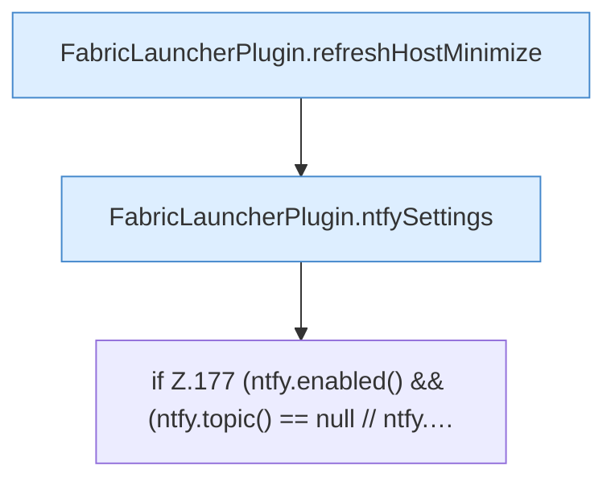

[[00 Start]] › [[Plugin-Kern]] › [[Lebenszyklus]] › [[FabricLauncherPlugin.onEnable]] › [[FabricLauncherPlugin.onEnable.Teil6]]

# FabricLauncherPlugin.onEnable.Teil6



```knoten
FabricLauncherPlugin.refreshHostMinimize
  Lädt neu `refreshHostMinimize`. Ruft `readHostMinimizeState`, `worldNameSafe`, `apply`.
FabricLauncherPlugin.ntfySettings
  `ntfySettings` in `FabricLauncherPlugin.java`.
if Z.177 (ntfy.enabled() && (ntfy.topic() == null // ntfy.…
  Zeile 177: prüft `(ntfy.enabled() && (ntfy.topic() == null // ntfy.…`.
```

- Fortsetzung von `FabricLauncherPlugin.onEnable`, Quellreihenfolge.
