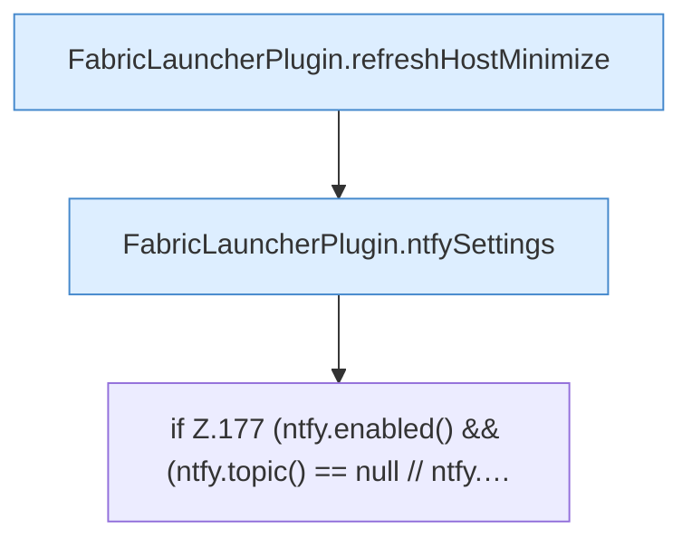

[[00 Start]] › [[Plugin-Kern]] › [[Lebenszyklus]] › [[FabricLauncherPlugin.onEnable]] › [[FabricLauncherPlugin.onEnable.Teil6]]

# FabricLauncherPlugin.onEnable.Teil6



```knoten
FabricLauncherPlugin.refreshHostMinimize
  Das [[Glossar#Plugin|Plugin]] lädt neu den [[Glossar#Host|Host]] das Verkleinern. Lädt neu `refreshHostMinimize`. Ruft `readHostMinimizeState`, `worldNameSafe`, `apply`.
FabricLauncherPlugin.ntfySettings
  Liest die [[Glossar#Einstellungen|Einstellungen]] für den Mitteilungsdienst. `ntfySettings` in `FabricLauncherPlugin.java`.
if Z.177 (ntfy.enabled() && (ntfy.topic() == null // ntfy.…
  Zeile 177: prüft `(ntfy.enabled() && (ntfy.topic() == null // ntfy.…`.
```

> [!knoten]- Was die Blöcke tun
> - **FabricLauncherPlugin.refreshHostMinimize**: Das [[Glossar#Plugin|Plugin]] lädt neu den [[Glossar#Host|Host]] das Verkleinern. Lädt neu `refreshHostMinimize`. Ruft `readHostMinimizeState`, `worldNameSafe`, `apply`.
> - **FabricLauncherPlugin.ntfySettings**: Liest die [[Glossar#Einstellungen|Einstellungen]] für den Mitteilungsdienst. `ntfySettings` in `FabricLauncherPlugin.java`.
> - **if Z.177 (ntfy.enabled() && (ntfy.topic() == null // ntfy.…**: Zeile 177: prüft `(ntfy.enabled() && (ntfy.topic() == null // ntfy.…`.

- Ein weiterer Abschnitt derselben Übersicht.
- Fortsetzung von `FabricLauncherPlugin.onEnable`.
