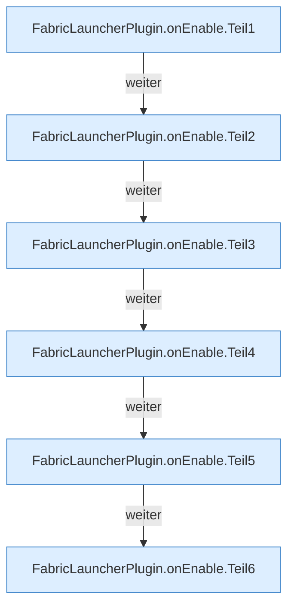
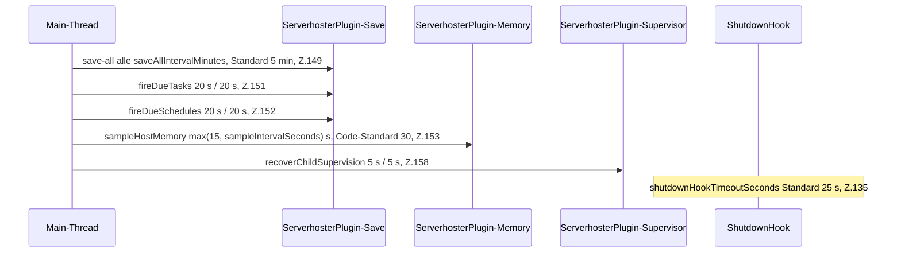

[[00 Start]] › [[Plugin-Kern]] › [[Lebenszyklus]] › [[FabricLauncherPlugin.onEnable]]

# FabricLauncherPlugin.onEnable

`FabricLauncherPlugin.onEnable()` [src/main/java/de/aichele/childlauncher/FabricLauncherPlugin.java:96–180](https://github.com/Sciddie/minecraft-serverhoster-plugin/blob/95b02b953b0b4c23673e900e021a7c3c844aa37d/src/main/java/de/aichele/childlauncher/FabricLauncherPlugin.java#L96-L180)



```knoten
FabricLauncherPlugin.onEnable.Teil1
  Ein weiterer Abschnitt derselben Übersicht. Im [[Glossar#Quelltext|Quelltext]] heißt das `Teil1`.
FabricLauncherPlugin.onEnable.Teil2
  Ein weiterer Abschnitt derselben Übersicht. Im [[Glossar#Quelltext|Quelltext]] heißt das `Teil2`.
FabricLauncherPlugin.onEnable.Teil3
  Ein weiterer Abschnitt derselben Übersicht. Im [[Glossar#Quelltext|Quelltext]] heißt das `Teil3`.
FabricLauncherPlugin.onEnable.Teil4
  Ein weiterer Abschnitt derselben Übersicht. Im [[Glossar#Quelltext|Quelltext]] heißt das `Teil4`.
FabricLauncherPlugin.onEnable.Teil5
  Ein weiterer Abschnitt derselben Übersicht. Im [[Glossar#Quelltext|Quelltext]] heißt das `Teil5`.
FabricLauncherPlugin.onEnable.Teil6
  Ein weiterer Abschnitt derselben Übersicht. Im [[Glossar#Quelltext|Quelltext]] heißt das `Teil6`.
```

> [!knoten]- Was die Blöcke tun
> - **FabricLauncherPlugin.onEnable.Teil1**: Ein weiterer Abschnitt derselben Übersicht. Im [[Glossar#Quelltext|Quelltext]] heißt das `Teil1`.
> - **FabricLauncherPlugin.onEnable.Teil2**: Ein weiterer Abschnitt derselben Übersicht. Im [[Glossar#Quelltext|Quelltext]] heißt das `Teil2`.
> - **FabricLauncherPlugin.onEnable.Teil3**: Ein weiterer Abschnitt derselben Übersicht. Im [[Glossar#Quelltext|Quelltext]] heißt das `Teil3`.
> - **FabricLauncherPlugin.onEnable.Teil4**: Ein weiterer Abschnitt derselben Übersicht. Im [[Glossar#Quelltext|Quelltext]] heißt das `Teil4`.
> - **FabricLauncherPlugin.onEnable.Teil5**: Ein weiterer Abschnitt derselben Übersicht. Im [[Glossar#Quelltext|Quelltext]] heißt das `Teil5`.
> - **FabricLauncherPlugin.onEnable.Teil6**: Ein weiterer Abschnitt derselben Übersicht. Im [[Glossar#Quelltext|Quelltext]] heißt das `Teil6`.



- Läuft, wenn der [[Glossar#Host|Host]] das [[Glossar#Plugin|Plugin]] einschaltet. [[Glossar#Einstellungen|Einstellungen]] werden gelesen, die [[Glossar#Wecker|Wecker]] starten, die [[Glossar#Bedienseite|Bedienseite]] geht auf.
- Auffällig: das kann sich anders verhalten, als man erwartet. Das nennt man [[Glossar#Unerwartetes Verhalten|Unerwartetes Verhalten]].
