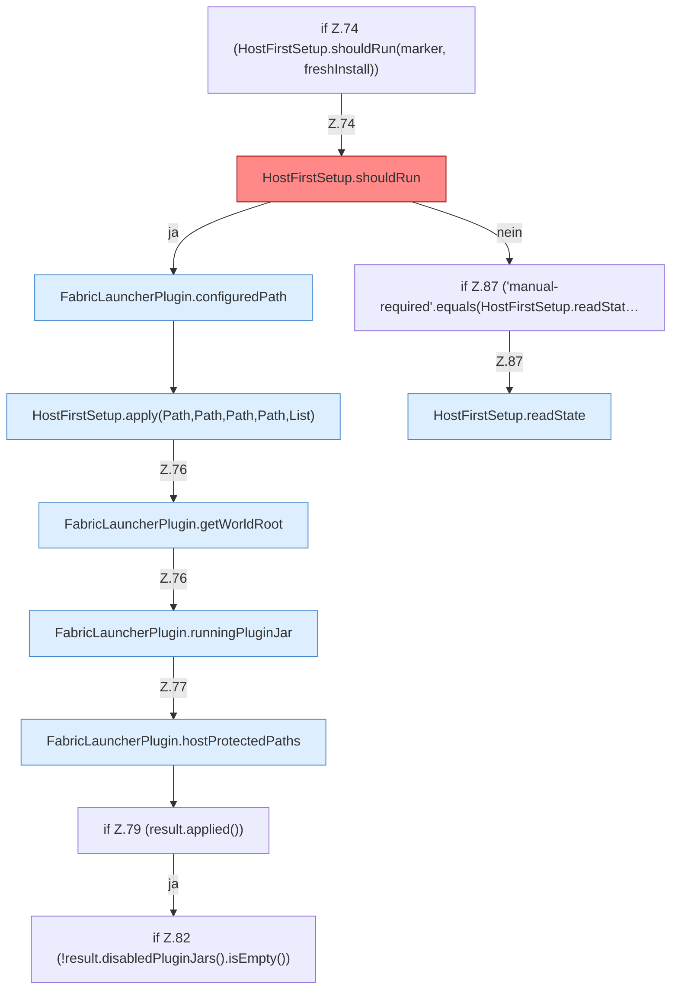

[[00 Start]] › [[Plugin-Kern]] › [[Lebenszyklus]] › [[FabricLauncherPlugin.onLoad]] › [[FabricLauncherPlugin.onLoad.Z73.Z74]]

# FabricLauncherPlugin.onLoad.Z73.Z74



```knoten
if Z.74 (HostFirstSetup.shouldRun(marker, freshInstall))
  Zeile 74: prüft `(HostFirstSetup.shouldRun(marker, freshInstall))`.
HostFirstSetup.shouldRun
  Entscheidet, ob `shouldRun`. Ruft `readState`, `writeMarker`. Befund: Altlast (wahrscheinlich).
FabricLauncherPlugin.configuredPath
  Liest den konfigurierten Wert `configuredPath`. Ruft `getWorldRoot`.
HostFirstSetup.apply(Path,Path,Path,Path,List)
  Wendet an `apply`. Ruft `readState`, `requireRoot`, `otherPluginJars`.
FabricLauncherPlugin.getWorldRoot
  Liefert `getWorldRoot`.
FabricLauncherPlugin.runningPluginJar
  Sagt, ob der Prozess läuft `runningPluginJar`.
FabricLauncherPlugin.hostProtectedPaths
  Betrifft den Host `hostProtectedPaths`. Ruft `getWorldRoot`, `directory`.
if Z.79 (result.applied())
  Zeile 79: prüft `(result.applied())`.
if Z.82 (!result.disabledPluginJars().isEmpty())
  Zeile 82: prüft `(!result.disabledPluginJars().isEmpty())`.
if Z.87 ('manual-required'.equals(HostFirstSetup.readStat…
  Zeile 87: prüft `('manual-required'.equals(HostFirstSetup.readStat…`.
HostFirstSetup.readState
  Liest `readState`. Ruft `readState`.
```

- Fortsetzung von `FabricLauncherPlugin.onLoad.Z73`, Quellreihenfolge.
