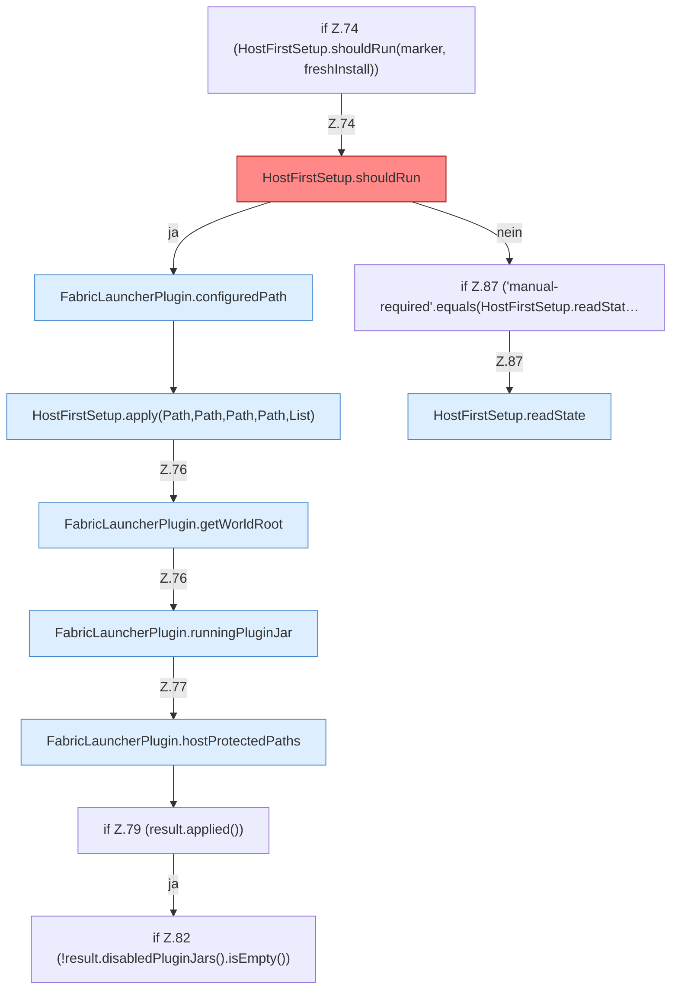

[[00 Start]] › [[Plugin-Kern]] › [[Lebenszyklus]] › [[FabricLauncherPlugin.onLoad]] › [[FabricLauncherPlugin.onLoad.Z73.Z74]]

# FabricLauncherPlugin.onLoad.Z73.Z74



```knoten
if Z.74 (HostFirstSetup.shouldRun(marker, freshInstall))
  Zeile 74: prüft `(HostFirstSetup.shouldRun(marker, freshInstall))`.
HostFirstSetup.shouldRun
  Die [[Glossar#Ersteinrichtung|Ersteinrichtung]] führt aus das. Entscheidet, ob `shouldRun`. Ruft `readState`, `writeMarker`. [[Glossar#Befund|Befund]]: [[Glossar#Altlast|Altlast]], wahrscheinlich. HostFirstSetup.java:35 akzeptiert pending; Schreibstelle nur HostMinimizeTest.java:216
FabricLauncherPlugin.configuredPath
  Liest einen Ordner so, wie er in den [[Glossar#Einstellungen|Einstellungen]] steht. Liest den konfigurierten Wert `configuredPath`. Ruft `getWorldRoot`.
HostFirstSetup.apply(Path,Path,Path,Path,List)
  Die [[Glossar#Ersteinrichtung|Ersteinrichtung]] wendet an das. Wendet an `apply`. Ruft `readState`, `requireRoot`, `otherPluginJars`.
FabricLauncherPlugin.getWorldRoot
  Das [[Glossar#Plugin|Plugin]] liefert die [[Glossar#Spielwelt|Spielwelt]] den Anfang. Liefert `getWorldRoot`.
FabricLauncherPlugin.runningPluginJar
  Das [[Glossar#Plugin|Plugin]] prüft, ob läuft, das Plugin die [[Glossar#Programmdatei|Programmdatei]]. Sagt, ob der [[Glossar#Prozess|Prozess]] läuft `runningPluginJar`.
FabricLauncherPlugin.hostProtectedPaths
  Die Ordner des [[Glossar#Host|Host]], die nicht gelöscht oder überschrieben werden dürfen. Betrifft den Host `hostProtectedPaths`. Ruft `getWorldRoot`, `directory`.
if Z.79 (result.applied())
  Zeile 79: prüft `(result.applied())`.
if Z.82 (!result.disabledPluginJars().isEmpty())
  Zeile 82: prüft `(!result.disabledPluginJars().isEmpty())`.
if Z.87 ('manual-required'.equals(HostFirstSetup.readStat…
  Zeile 87: prüft `('manual-required'.equals(HostFirstSetup.readStat…`.
HostFirstSetup.readState
  Die [[Glossar#Ersteinrichtung|Ersteinrichtung]] liest den Zustand. Liest `readState`. Ruft `readState`.
```

> [!knoten]- Was die Blöcke tun
> - **if Z.74 (HostFirstSetup.shouldRun(marker, freshInstall))**: Zeile 74: prüft `(HostFirstSetup.shouldRun(marker, freshInstall))`.
> - **HostFirstSetup.shouldRun**: Die [[Glossar#Ersteinrichtung|Ersteinrichtung]] führt aus das. Entscheidet, ob `shouldRun`. Ruft `readState`, `writeMarker`. [[Glossar#Befund|Befund]]: [[Glossar#Altlast|Altlast]], wahrscheinlich. HostFirstSetup.java:35 akzeptiert pending; Schreibstelle nur HostMinimizeTest.java:216
> - **FabricLauncherPlugin.configuredPath**: Liest einen Ordner so, wie er in den [[Glossar#Einstellungen|Einstellungen]] steht. Liest den konfigurierten Wert `configuredPath`. Ruft `getWorldRoot`.
> - **HostFirstSetup.apply(Path,Path,Path,Path,List)**: Die [[Glossar#Ersteinrichtung|Ersteinrichtung]] wendet an das. Wendet an `apply`. Ruft `readState`, `requireRoot`, `otherPluginJars`.
> - **FabricLauncherPlugin.getWorldRoot**: Das [[Glossar#Plugin|Plugin]] liefert die [[Glossar#Spielwelt|Spielwelt]] den Anfang. Liefert `getWorldRoot`.
> - **FabricLauncherPlugin.runningPluginJar**: Das [[Glossar#Plugin|Plugin]] prüft, ob läuft, das Plugin die [[Glossar#Programmdatei|Programmdatei]]. Sagt, ob der [[Glossar#Prozess|Prozess]] läuft `runningPluginJar`.
> - **FabricLauncherPlugin.hostProtectedPaths**: Die Ordner des [[Glossar#Host|Host]], die nicht gelöscht oder überschrieben werden dürfen. Betrifft den Host `hostProtectedPaths`. Ruft `getWorldRoot`, `directory`.
> - **if Z.79 (result.applied())**: Zeile 79: prüft `(result.applied())`.
> - **if Z.82 (!result.disabledPluginJars().isEmpty())**: Zeile 82: prüft `(!result.disabledPluginJars().isEmpty())`.
> - **if Z.87 ('manual-required'.equals(HostFirstSetup.readStat…**: Zeile 87: prüft `('manual-required'.equals(HostFirstSetup.readStat…`.
> - **HostFirstSetup.readState**: Die [[Glossar#Ersteinrichtung|Ersteinrichtung]] liest den Zustand. Liest `readState`. Ruft `readState`.

- Der Ablauf geht in [[Glossar#Zeile|Zeile]] 74 weiter. Eine Ebene tiefer steht er genauer.
- Fortsetzung von `FabricLauncherPlugin.onLoad.Z73`.
