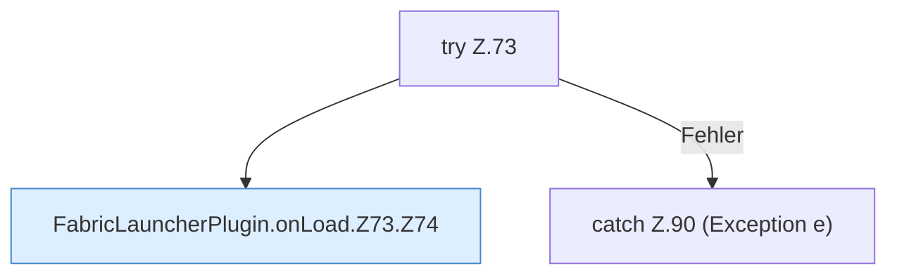

[[00 Start]] › [[Plugin-Kern]] › [[Lebenszyklus]] › [[FabricLauncherPlugin.onLoad]] › [[FabricLauncherPlugin.onLoad.Z73]]

# FabricLauncherPlugin.onLoad.Z73

- Fortsetzung von `FabricLauncherPlugin.onLoad`, Quellreihenfolge.
