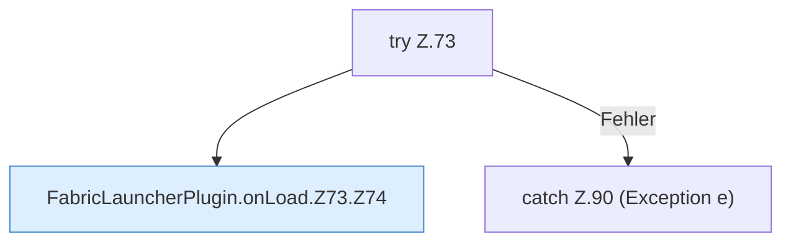

[[00 Start]] › [[Plugin-Kern]] › [[Lebenszyklus]] › [[FabricLauncherPlugin.onLoad]] › [[FabricLauncherPlugin.onLoad.Z73]]

# FabricLauncherPlugin.onLoad.Z73



```knoten
try Z.73
  Zeile 73: Versuch. Der Fehlerpfad geht in catch.
FabricLauncherPlugin.onLoad.Z73.Z74
  Der Ablauf geht in [[Glossar#Zeile|Zeile]] 74 weiter. Eine Ebene tiefer steht er genauer. Fortsetzung des Ablaufs ab Zeile 74.
catch Z.90 (Exception e)
  Zeile 90: fängt (Exception e).
```

> [!knoten]- Was die Blöcke tun
> - **try Z.73**: Zeile 73: Versuch. Der Fehlerpfad geht in catch.
> - **FabricLauncherPlugin.onLoad.Z73.Z74**: Der Ablauf geht in [[Glossar#Zeile|Zeile]] 74 weiter. Eine Ebene tiefer steht er genauer. Fortsetzung des Ablaufs ab Zeile 74.
> - **catch Z.90 (Exception e)**: Zeile 90: fängt (Exception e).

- Der Ablauf geht in [[Glossar#Zeile|Zeile]] 73 weiter. Eine Ebene tiefer steht er genauer.
- Fortsetzung von `FabricLauncherPlugin.onLoad`.
