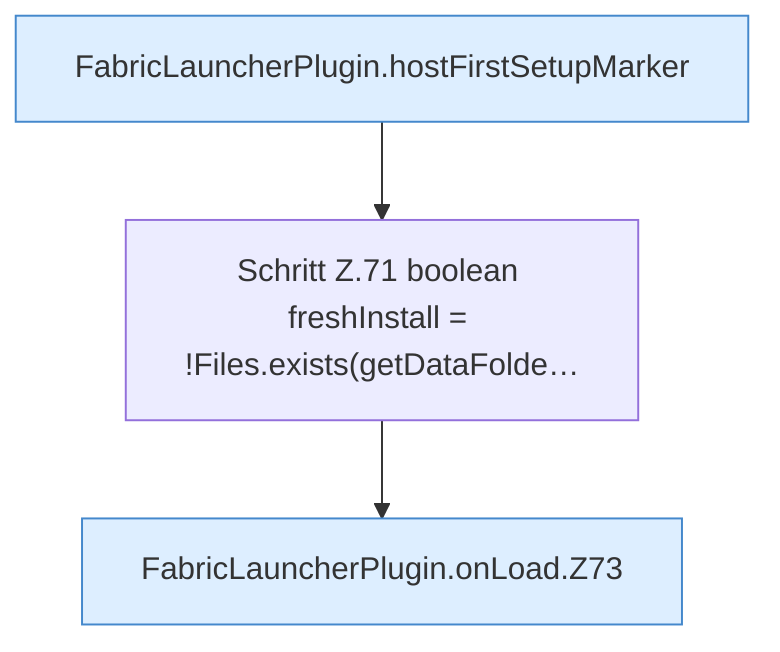

[[00 Start]] › [[Plugin-Kern]] › [[Lebenszyklus]] › [[FabricLauncherPlugin.onLoad]]

# FabricLauncherPlugin.onLoad

`FabricLauncherPlugin.onLoad()` [src/main/java/de/aichele/childlauncher/FabricLauncherPlugin.java:69–94](https://github.com/Sciddie/minecraft-serverhoster-plugin/blob/95b02b953b0b4c23673e900e021a7c3c844aa37d/src/main/java/de/aichele/childlauncher/FabricLauncherPlugin.java#L69-L94)



```knoten
FabricLauncherPlugin.hostFirstSetupMarker
  Liest oder schreibt die Merkdatei der [[Glossar#Ersteinrichtung|Ersteinrichtung]]. Im [[Glossar#Quelltext|Quelltext]] heißt das `hostFirstSetupMarker`.
Schritt Z.71 boolean freshInstall = !Files.exists(getDataFolde…
  Ein einzelner Arbeitsschritt, ohne eine weitere eigene [[Glossar#Funktion|Funktion]] aufzurufen. Das steht in [[Glossar#Zeile|Zeile]] 71.
FabricLauncherPlugin.onLoad.Z73
  Der Ablauf geht in [[Glossar#Zeile|Zeile]] 73 weiter. Eine Ebene tiefer steht er genauer. Im [[Glossar#Quelltext|Quelltext]] heißt das `Z73`.
```

> [!knoten]- Was die Blöcke tun
> - **FabricLauncherPlugin.hostFirstSetupMarker**: Liest oder schreibt die Merkdatei der [[Glossar#Ersteinrichtung|Ersteinrichtung]]. Im [[Glossar#Quelltext|Quelltext]] heißt das `hostFirstSetupMarker`.
> - **Schritt Z.71 boolean freshInstall = !Files.exists(getDataFolde…**: Ein einzelner Arbeitsschritt, ohne eine weitere eigene [[Glossar#Funktion|Funktion]] aufzurufen. Das steht in [[Glossar#Zeile|Zeile]] 71.
> - **FabricLauncherPlugin.onLoad.Z73**: Der Ablauf geht in [[Glossar#Zeile|Zeile]] 73 weiter. Eine Ebene tiefer steht er genauer. Im [[Glossar#Quelltext|Quelltext]] heißt das `Z73`.

- Läuft ganz am Anfang, noch bevor die Welten des [[Glossar#Host|Host]] geladen sind. Hier wird die Merkdatei der [[Glossar#Ersteinrichtung|Ersteinrichtung]] angeschaut.
