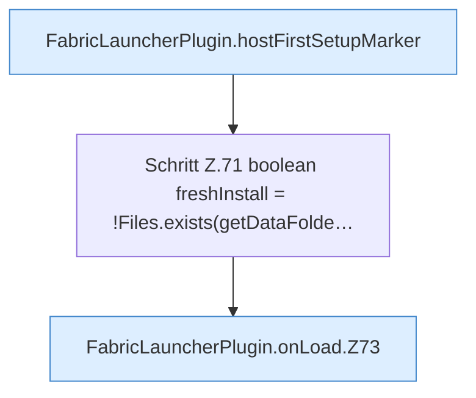

[[00 Start]] › [[Plugin-Kern]] › [[Lebenszyklus]] › [[FabricLauncherPlugin.onLoad]]

# FabricLauncherPlugin.onLoad

`FabricLauncherPlugin.onLoad()` [src/main/java/de/aichele/childlauncher/FabricLauncherPlugin.java:69–94](https://github.com/Sciddie/minecraft-serverhoster-plugin/blob/95b02b953b0b4c23673e900e021a7c3c844aa37d/src/main/java/de/aichele/childlauncher/FabricLauncherPlugin.java#L69-L94)

- Spigot `onLoad`: Marker `HostFirstSetup`, bevor Welten laden.
