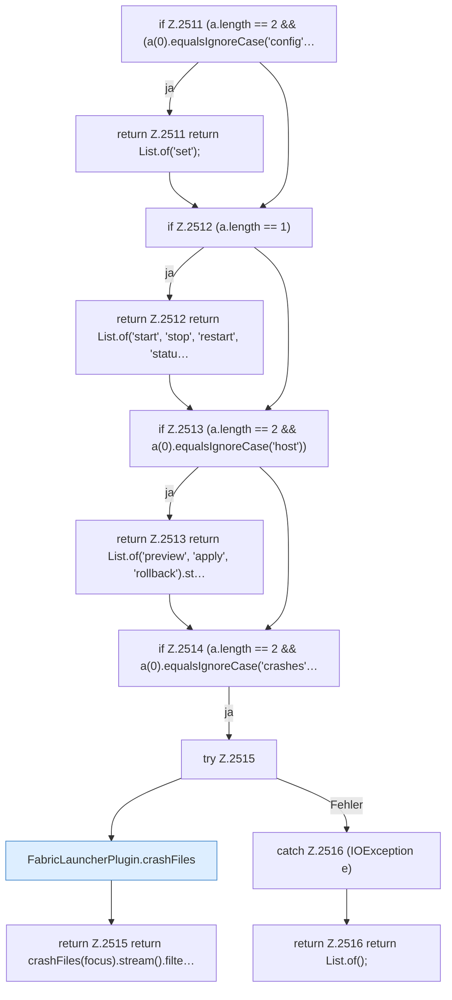

[[00 Start]] › [[Plugin-Kern]] › [[Befehle]] › [[FabricLauncherPlugin.onTabComplete]] › [[FabricLauncherPlugin.onTabComplete.Teil1]]

# FabricLauncherPlugin.onTabComplete.Teil1

- Fortsetzung von `FabricLauncherPlugin.onTabComplete`, Quellreihenfolge.
