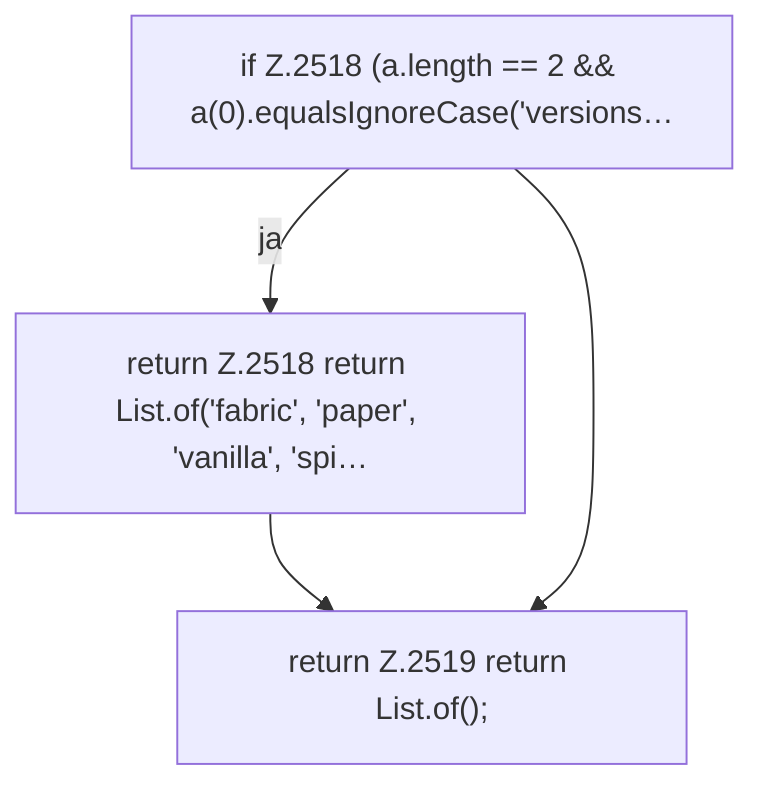

[[00 Start]] › [[Plugin-Kern]] › [[Befehle]] › [[FabricLauncherPlugin.onTabComplete]] › [[FabricLauncherPlugin.onTabComplete.Teil2]]

# FabricLauncherPlugin.onTabComplete.Teil2



```knoten
if Z.2518 (a.length == 2 && a(0).equalsIgnoreCase('versions…
  Zeile 2518: prüft `(a.length == 2 && a(0).equalsIgnoreCase('versions…`.
return Z.2518 return List.of('fabric', 'paper', 'vanilla', 'spi…
  Zeile 2518: Rückgabe `return List.of('fabric', 'paper', 'vanilla', 'spi…`.
return Z.2519 return List.of();
  Zeile 2519: Rückgabe `return List.of();`.
```

> [!knoten]- Was die Blöcke tun
> - **if Z.2518 (a.length == 2 && a(0).equalsIgnoreCase('versions…**: Zeile 2518: prüft `(a.length == 2 && a(0).equalsIgnoreCase('versions…`.
> - **return Z.2518 return List.of('fabric', 'paper', 'vanilla', 'spi…**: Zeile 2518: Rückgabe `return List.of('fabric', 'paper', 'vanilla', 'spi…`.
> - **return Z.2519 return List.of();**: Zeile 2519: Rückgabe `return List.of();`.

- Ein weiterer Abschnitt derselben Übersicht.
- Fortsetzung von `FabricLauncherPlugin.onTabComplete`.
