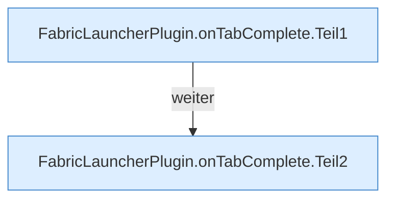

[[00 Start]] › [[Plugin-Kern]] › [[Befehle]] › [[FabricLauncherPlugin.onTabComplete]]

# FabricLauncherPlugin.onTabComplete

`FabricLauncherPlugin.onTabComplete(CommandSender s, Command c, String l, String[] a)` [src/main/java/de/aichele/childlauncher/FabricLauncherPlugin.java:2510–2520](https://github.com/Sciddie/minecraft-serverhoster-plugin/blob/95b02b953b0b4c23673e900e021a7c3c844aa37d/src/main/java/de/aichele/childlauncher/FabricLauncherPlugin.java#L2510-L2520)



```knoten
FabricLauncherPlugin.onTabComplete.Teil1
  Ein weiterer Abschnitt derselben Übersicht. Im [[Glossar#Quelltext|Quelltext]] heißt das `Teil1`.
FabricLauncherPlugin.onTabComplete.Teil2
  Ein weiterer Abschnitt derselben Übersicht. Im [[Glossar#Quelltext|Quelltext]] heißt das `Teil2`.
```

> [!knoten]- Was die Blöcke tun
> - **FabricLauncherPlugin.onTabComplete.Teil1**: Ein weiterer Abschnitt derselben Übersicht. Im [[Glossar#Quelltext|Quelltext]] heißt das `Teil1`.
> - **FabricLauncherPlugin.onTabComplete.Teil2**: Ein weiterer Abschnitt derselben Übersicht. Im [[Glossar#Quelltext|Quelltext]] heißt das `Teil2`.

- Schlägt die nächsten Wörter vor, während jemand /child tippt.
