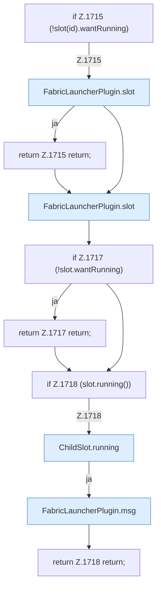

[[00 Start]] › [[Child-Prozess]] › [[Startablauf]] › [[FabricLauncherPlugin.openChild]] › [[FabricLauncherPlugin.openChild.Z1714.Teil1]]

# FabricLauncherPlugin.openChild.Z1714.Teil1



```knoten
if Z.1715 (!slot(id).wantRunning)
  Zeile 1715: prüft `(!slot(id).wantRunning)`.
FabricLauncherPlugin.slot
  `slot` in `FabricLauncherPlugin.java`. Ruft `profile`, `ChildSlot`.
return Z.1715 return;
  Zeile 1715: Rückgabe `return;`.
if Z.1717 (!slot.wantRunning)
  Zeile 1717: prüft `(!slot.wantRunning)`.
return Z.1717 return;
  Zeile 1717: Rückgabe `return;`.
if Z.1718 (slot.running())
  Zeile 1718: prüft `(slot.running())`.
ChildSlot.running
  Sagt, ob der Prozess läuft `running`.
FabricLauncherPlugin.msg
  Sendet eine Chat-Zeile `msg`.
return Z.1718 return;
  Zeile 1718: Rückgabe `return;`.
```

- Fortsetzung von `FabricLauncherPlugin.openChild.Z1714`, Quellreihenfolge.
