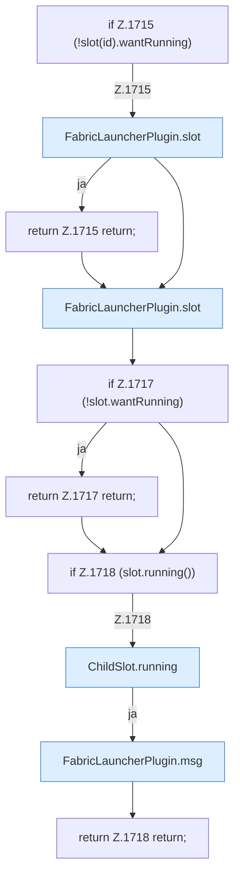

[[00 Start]] › [[Child-Prozess]] › [[Startablauf]] › [[FabricLauncherPlugin.openChild]] › [[FabricLauncherPlugin.openChild.Z1714.Teil1]]

# FabricLauncherPlugin.openChild.Z1714.Teil1

- Fortsetzung von `FabricLauncherPlugin.openChild.Z1714`, Quellreihenfolge.
