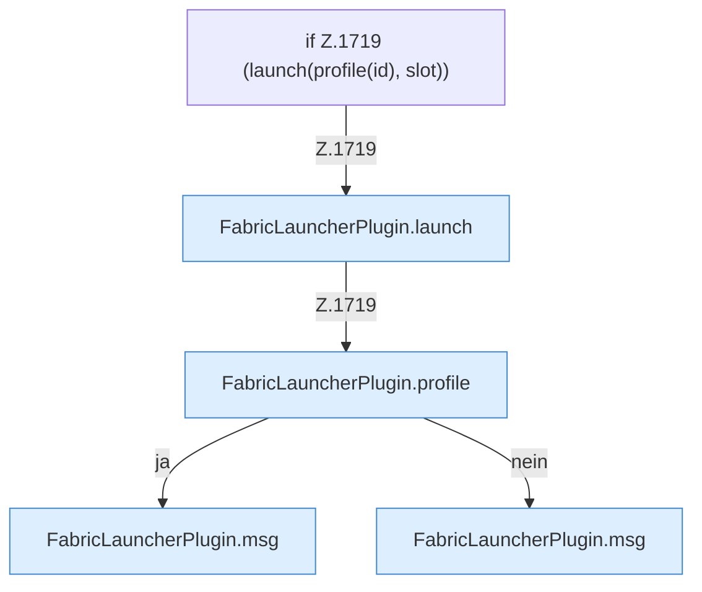

[[00 Start]] › [[Child-Prozess]] › [[Startablauf]] › [[FabricLauncherPlugin.openChild]] › [[FabricLauncherPlugin.openChild.Z1714.Teil2]]

# FabricLauncherPlugin.openChild.Z1714.Teil2



```knoten
if Z.1719 (launch(profile(id), slot))
  Zeile 1719: prüft `(launch(profile(id), slot))`.
FabricLauncherPlugin.launch
  Startet den Prozess `launch`. Ruft `running`, `directory`, `copyPlayerFiles`.
FabricLauncherPlugin.profile
  `profile` in `FabricLauncherPlugin.java`.
FabricLauncherPlugin.msg
  Sendet eine Chat-Zeile `msg`.
```

- Fortsetzung von `FabricLauncherPlugin.openChild.Z1714`, Quellreihenfolge.
