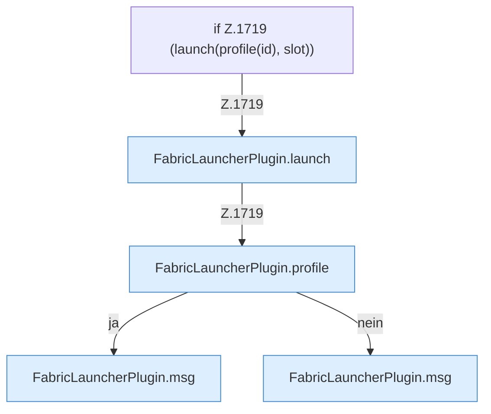

[[00 Start]] › [[Child-Prozess]] › [[Startablauf]] › [[FabricLauncherPlugin.openChild]] › [[FabricLauncherPlugin.openChild.Z1714.Teil2]]

# FabricLauncherPlugin.openChild.Z1714.Teil2



```knoten
if Z.1719 (launch(profile(id), slot))
  Zeile 1719: prüft `(launch(profile(id), slot))`.
FabricLauncherPlugin.launch
  Legt Ordner und Dateien an, schreibt die [[Glossar#Lizenz|Lizenz]], startet das Programm und schaltet Mitlesen und [[Glossar#Aufsicht|Aufsicht]] an. Scheitert das, wird aufgeräumt. Startet den [[Glossar#Prozess|Prozess]] `launch`. Ruft `running`, `directory`, `copyPlayerFiles`.
FabricLauncherPlugin.profile
  Das [[Glossar#Plugin|Plugin]] macht hier einen einzelnen Schritt. Eine Ebene tiefer steht er genauer. `profile` in `FabricLauncherPlugin.java`.
FabricLauncherPlugin.msg
  Schickt eine [[Glossar#Zeile|Zeile]] an den Menschen, der einen [[Glossar#Befehl|Befehl]] getippt hat. Sendet eine Chat-Zeile `msg`.
```

> [!knoten]- Was die Blöcke tun
> - **if Z.1719 (launch(profile(id), slot))**: Zeile 1719: prüft `(launch(profile(id), slot))`.
> - **FabricLauncherPlugin.launch**: Legt Ordner und Dateien an, schreibt die [[Glossar#Lizenz|Lizenz]], startet das Programm und schaltet Mitlesen und [[Glossar#Aufsicht|Aufsicht]] an. Scheitert das, wird aufgeräumt. Startet den [[Glossar#Prozess|Prozess]] `launch`. Ruft `running`, `directory`, `copyPlayerFiles`.
> - **FabricLauncherPlugin.profile**: Das [[Glossar#Plugin|Plugin]] macht hier einen einzelnen Schritt. Eine Ebene tiefer steht er genauer. `profile` in `FabricLauncherPlugin.java`.
> - **FabricLauncherPlugin.msg**: Schickt eine [[Glossar#Zeile|Zeile]] an den Menschen, der einen [[Glossar#Befehl|Befehl]] getippt hat. Sendet eine Chat-Zeile `msg`.

- Ein weiterer Abschnitt derselben Übersicht.
- Fortsetzung von `FabricLauncherPlugin.openChild.Z1714`.
