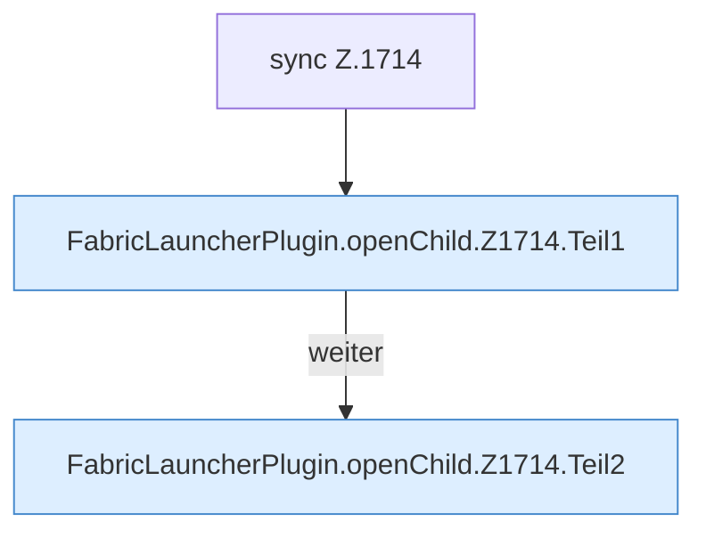

[[00 Start]] › [[Child-Prozess]] › [[Startablauf]] › [[FabricLauncherPlugin.openChild]] › [[FabricLauncherPlugin.openChild.Z1714]]

# FabricLauncherPlugin.openChild.Z1714



```knoten
sync Z.1714
  Zeile 1714: synchronisierter Block.
FabricLauncherPlugin.openChild.Z1714.Teil1
  Abschnitt 1 dieses Ablaufs, in Quellreihenfolge.
FabricLauncherPlugin.openChild.Z1714.Teil2
  Abschnitt 2 dieses Ablaufs, in Quellreihenfolge.
```

- Fortsetzung von `FabricLauncherPlugin.openChild`, Quellreihenfolge.
