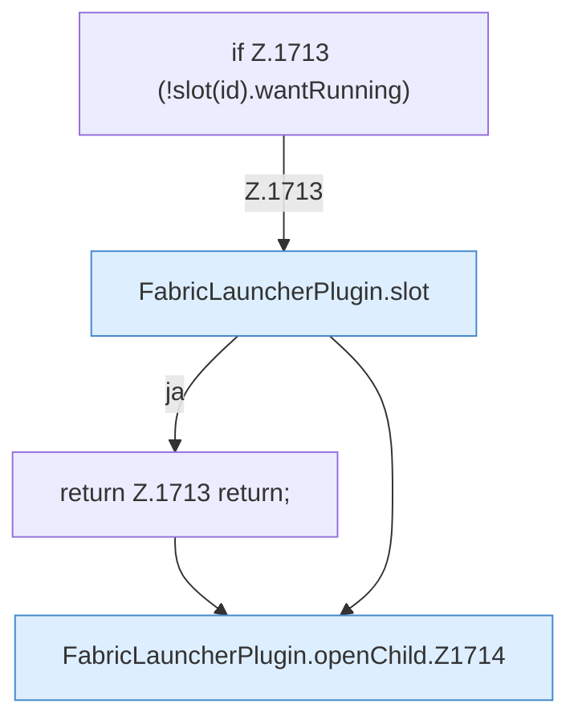

[[00 Start]] › [[Child-Prozess]] › [[Startablauf]] › [[FabricLauncherPlugin.openChild]]

# FabricLauncherPlugin.openChild

`FabricLauncherPlugin.openChild(CommandSender s, String id)` [src/main/java/de/aichele/childlauncher/FabricLauncherPlugin.java:1712–1722](https://github.com/Sciddie/minecraft-serverhoster-plugin/blob/95b02b953b0b4c23673e900e021a7c3c844aa37d/src/main/java/de/aichele/childlauncher/FabricLauncherPlugin.java#L1712-L1722)



```knoten
if Z.1713 (!slot(id).wantRunning)
  Hier fällt eine Entscheidung. Nur wenn sie zutrifft, geht es den Ja-Weg weiter. Das steht in [[Glossar#Zeile|Zeile]] 1713.
FabricLauncherPlugin.slot
  Das [[Glossar#Plugin|Plugin]] macht hier einen einzelnen Schritt. Eine Ebene tiefer steht er genauer. Im [[Glossar#Quelltext|Quelltext]] heißt das `slot`.
return Z.1713 return;
  Hier endet die [[Glossar#Funktion|Funktion]] und liefert ein Ergebnis zurück. Das steht in [[Glossar#Zeile|Zeile]] 1713.
FabricLauncherPlugin.openChild.Z1714
  Der Ablauf geht in [[Glossar#Zeile|Zeile]] 1714 weiter. Eine Ebene tiefer steht er genauer. Im [[Glossar#Quelltext|Quelltext]] heißt das `Z1714`.
```

> [!knoten]- Was die Blöcke tun
> - **if Z.1713 (!slot(id).wantRunning)**: Hier fällt eine Entscheidung. Nur wenn sie zutrifft, geht es den Ja-Weg weiter. Das steht in [[Glossar#Zeile|Zeile]] 1713.
> - **FabricLauncherPlugin.slot**: Das [[Glossar#Plugin|Plugin]] macht hier einen einzelnen Schritt. Eine Ebene tiefer steht er genauer. Im [[Glossar#Quelltext|Quelltext]] heißt das `slot`.
> - **return Z.1713 return;**: Hier endet die [[Glossar#Funktion|Funktion]] und liefert ein Ergebnis zurück. Das steht in [[Glossar#Zeile|Zeile]] 1713.
> - **FabricLauncherPlugin.openChild.Z1714**: Der Ablauf geht in [[Glossar#Zeile|Zeile]] 1714 weiter. Eine Ebene tiefer steht er genauer. Im [[Glossar#Quelltext|Quelltext]] heißt das `Z1714`.

- Prüft, ob der [[Glossar#Platz|Platz]] frei ist, und gibt den Start dann weiter. Läuft er schon, passiert nichts.
