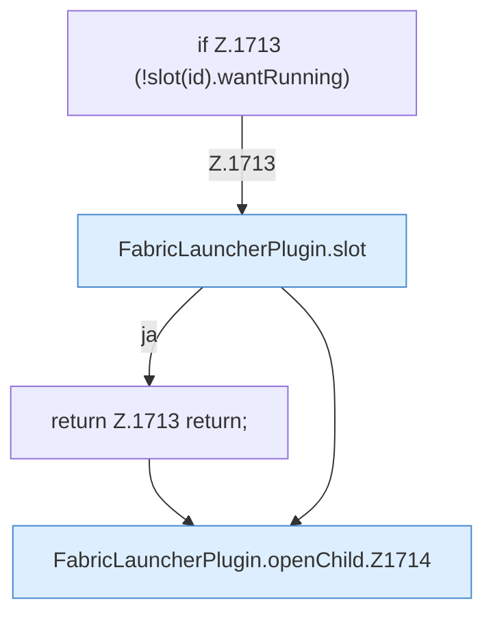

[[00 Start]] › [[Child-Prozess]] › [[Startablauf]] › [[FabricLauncherPlugin.openChild]]

# FabricLauncherPlugin.openChild

`FabricLauncherPlugin.openChild(CommandSender s, String id)` [src/main/java/de/aichele/childlauncher/FabricLauncherPlugin.java:1712–1722](https://github.com/Sciddie/minecraft-serverhoster-plugin/blob/95b02b953b0b4c23673e900e021a7c3c844aa37d/src/main/java/de/aichele/childlauncher/FabricLauncherPlugin.java#L1712-L1722)



```knoten
if Z.1713 (!slot(id).wantRunning)
  Zeile 1713: prüft `(!slot(id).wantRunning)`.
FabricLauncherPlugin.slot
  `slot` in `FabricLauncherPlugin.java`. Ruft `profile`, `ChildSlot`.
return Z.1713 return;
  Zeile 1713: Rückgabe `return;`.
FabricLauncherPlugin.openChild.Z1714
  Fortsetzung des Ablaufs ab Zeile 1714.
```

- `openChild` in `src/main/java/de/aichele/childlauncher/FabricLauncherPlugin.java`
