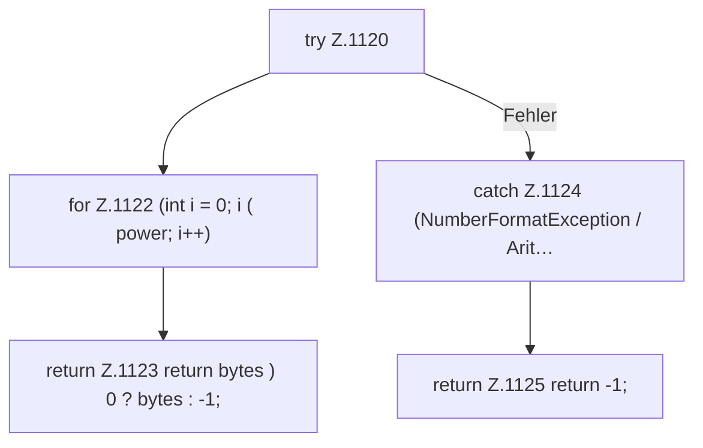

[[00 Start]] › [[Host-Betrieb]] › [[Speicher-Probe]] › [[FabricLauncherPlugin.parseMemoryBytes]] › [[FabricLauncherPlugin.parseMemoryBytes.Teil3]]

# FabricLauncherPlugin.parseMemoryBytes.Teil3

- Fortsetzung von `FabricLauncherPlugin.parseMemoryBytes`, Quellreihenfolge.
