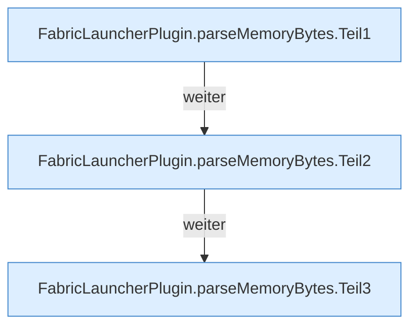

[[00 Start]] › [[Host-Betrieb]] › [[Speicher-Probe]] › [[FabricLauncherPlugin.parseMemoryBytes]]

# FabricLauncherPlugin.parseMemoryBytes

`FabricLauncherPlugin.parseMemoryBytes(String value)` [src/main/java/de/aichele/childlauncher/FabricLauncherPlugin.java:1106–1127](https://github.com/Sciddie/minecraft-serverhoster-plugin/blob/95b02b953b0b4c23673e900e021a7c3c844aa37d/src/main/java/de/aichele/childlauncher/FabricLauncherPlugin.java#L1106-L1127)

- `parseMemoryBytes` in `src/main/java/de/aichele/childlauncher/FabricLauncherPlugin.java`
