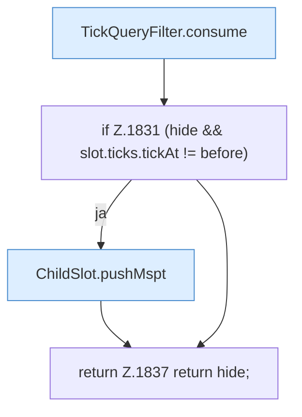

[[00 Start]] › [[Child-Prozess]] › [[Pipe-Watch]] › [[FabricLauncherPlugin.parseTick]]

# FabricLauncherPlugin.parseTick

`FabricLauncherPlugin.parseTick(ChildSlot slot, String line)` [src/main/java/de/aichele/childlauncher/FabricLauncherPlugin.java:1828–1838](https://github.com/Sciddie/minecraft-serverhoster-plugin/blob/95b02b953b0b4c23673e900e021a7c3c844aa37d/src/main/java/de/aichele/childlauncher/FabricLauncherPlugin.java#L1828-L1838)



```knoten
TickQueryFilter.consume
  Dieser Teil macht hier einen einzelnen Schritt. Eine Ebene tiefer steht er genauer. Im [[Glossar#Quelltext|Quelltext]] heißt das `consume`.
if Z.1831 (hide && slot.ticks.tickAt != before)
  Hier fällt eine Entscheidung. Nur wenn sie zutrifft, geht es den Ja-Weg weiter. Das steht in [[Glossar#Zeile|Zeile]] 1831.
ChildSlot.pushMspt
  Dieser Teil kümmert sich um die [[Glossar#Spielschritt|Spielschritte]]. Im [[Glossar#Quelltext|Quelltext]] heißt das `pushMspt`.
return Z.1837 return hide;
  Hier endet die [[Glossar#Funktion|Funktion]] und liefert ein Ergebnis zurück. Das steht in [[Glossar#Zeile|Zeile]] 1837.
```

> [!knoten]- Was die Blöcke tun
> - **TickQueryFilter.consume**: Dieser Teil macht hier einen einzelnen Schritt. Eine Ebene tiefer steht er genauer. Im [[Glossar#Quelltext|Quelltext]] heißt das `consume`.
> - **if Z.1831 (hide && slot.ticks.tickAt != before)**: Hier fällt eine Entscheidung. Nur wenn sie zutrifft, geht es den Ja-Weg weiter. Das steht in [[Glossar#Zeile|Zeile]] 1831.
> - **ChildSlot.pushMspt**: Dieser Teil kümmert sich um die [[Glossar#Spielschritt|Spielschritte]]. Im [[Glossar#Quelltext|Quelltext]] heißt das `pushMspt`.
> - **return Z.1837 return hide;**: Hier endet die [[Glossar#Funktion|Funktion]] und liefert ein Ergebnis zurück. Das steht in [[Glossar#Zeile|Zeile]] 1837.

- Liest aus einer Antwort, wie lange der letzte [[Glossar#Spielschritt|Spielschritt]] gedauert hat.
