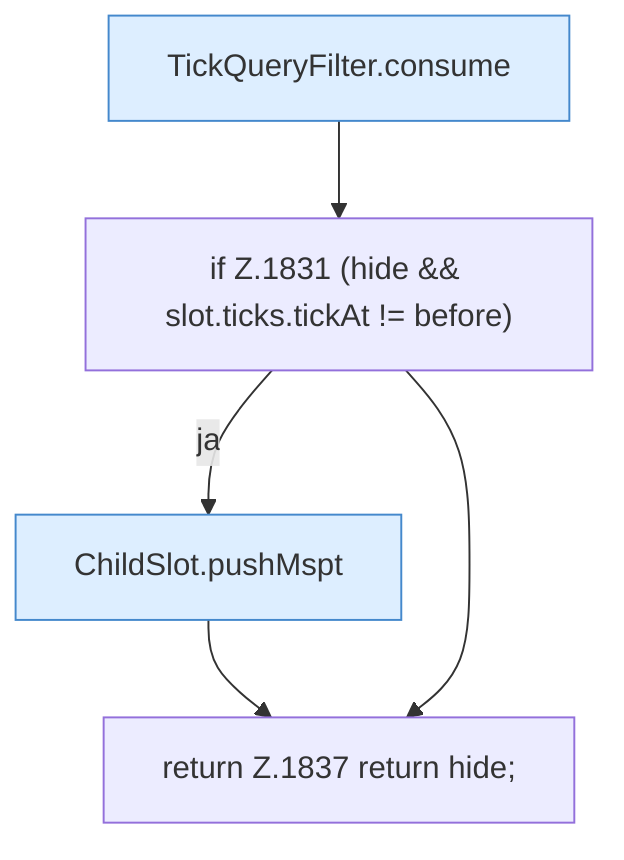

[[00 Start]] › [[Child-Prozess]] › [[Pipe-Watch]] › [[FabricLauncherPlugin.parseTick]]

# FabricLauncherPlugin.parseTick

`FabricLauncherPlugin.parseTick(ChildSlot slot, String line)` [src/main/java/de/aichele/childlauncher/FabricLauncherPlugin.java:1828–1838](https://github.com/Sciddie/minecraft-serverhoster-plugin/blob/95b02b953b0b4c23673e900e021a7c3c844aa37d/src/main/java/de/aichele/childlauncher/FabricLauncherPlugin.java#L1828-L1838)



```knoten
TickQueryFilter.consume
  Filtert `consume`.
if Z.1831 (hide && slot.ticks.tickAt != before)
  Zeile 1831: prüft `(hide && slot.ticks.tickAt != before)`.
ChildSlot.pushMspt
  Schiebt einen Wert in `pushMspt`.
return Z.1837 return hide;
  Zeile 1837: Rückgabe `return hide;`.
```

- `parseTick` in `src/main/java/de/aichele/childlauncher/FabricLauncherPlugin.java`
