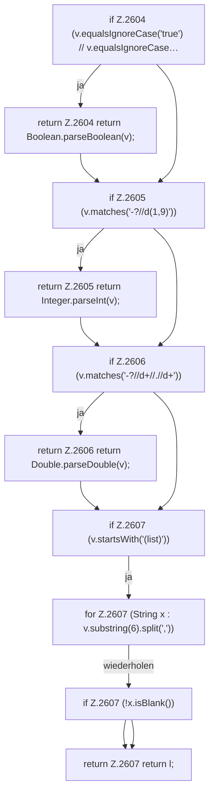

[[00 Start]] › [[Plugin-Kern]] › [[Properties]] › [[FabricLauncherPlugin.parseValue]] › [[FabricLauncherPlugin.parseValue.Teil1]]

# FabricLauncherPlugin.parseValue.Teil1



```knoten
if Z.2604 (v.equalsIgnoreCase('true') // v.equalsIgnoreCase…
  Zeile 2604: prüft `(v.equalsIgnoreCase('true') // v.equalsIgnoreCase…`.
return Z.2604 return Boolean.parseBoolean(v);
  Zeile 2604: Rückgabe `return Boolean.parseBoolean(v);`.
if Z.2605 (v.matches('-?//d(1,9)'))
  Zeile 2605: prüft `(v.matches('-?//d(1,9)'))`.
return Z.2605 return Integer.parseInt(v);
  Zeile 2605: Rückgabe `return Integer.parseInt(v);`.
if Z.2606 (v.matches('-?//d+//.//d+'))
  Zeile 2606: prüft `(v.matches('-?//d+//.//d+'))`.
return Z.2606 return Double.parseDouble(v);
  Zeile 2606: Rückgabe `return Double.parseDouble(v);`.
if Z.2607 (v.startsWith('(list)'))
  Zeile 2607: prüft `(v.startsWith('(list)'))`.
for Z.2607 (String x : v.substring(6).split(','))
  Zeile 2607: Schleife `(String x : v.substring(6).split(','))`.
if Z.2607 (!x.isBlank())
  Zeile 2607: prüft `(!x.isBlank())`.
return Z.2607 return l;
  Zeile 2607: Rückgabe `return l;`.
```

> [!knoten]- Was die Blöcke tun
> - **if Z.2604 (v.equalsIgnoreCase('true') // v.equalsIgnoreCase…**: Zeile 2604: prüft `(v.equalsIgnoreCase('true') // v.equalsIgnoreCase…`.
> - **return Z.2604 return Boolean.parseBoolean(v);**: Zeile 2604: Rückgabe `return Boolean.parseBoolean(v);`.
> - **if Z.2605 (v.matches('-?//d(1,9)'))**: Zeile 2605: prüft `(v.matches('-?//d(1,9)'))`.
> - **return Z.2605 return Integer.parseInt(v);**: Zeile 2605: Rückgabe `return Integer.parseInt(v);`.
> - **if Z.2606 (v.matches('-?//d+//.//d+'))**: Zeile 2606: prüft `(v.matches('-?//d+//.//d+'))`.
> - **return Z.2606 return Double.parseDouble(v);**: Zeile 2606: Rückgabe `return Double.parseDouble(v);`.
> - **if Z.2607 (v.startsWith('(list)'))**: Zeile 2607: prüft `(v.startsWith('(list)'))`.
> - **for Z.2607 (String x : v.substring(6).split(','))**: Zeile 2607: Schleife `(String x : v.substring(6).split(','))`.
> - **if Z.2607 (!x.isBlank())**: Zeile 2607: prüft `(!x.isBlank())`.
> - **return Z.2607 return l;**: Zeile 2607: Rückgabe `return l;`.

- Ein weiterer Abschnitt derselben Übersicht.
- Fortsetzung von `FabricLauncherPlugin.parseValue`.
