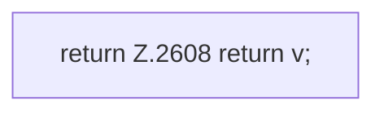

[[00 Start]] › [[Plugin-Kern]] › [[Properties]] › [[FabricLauncherPlugin.parseValue]] › [[FabricLauncherPlugin.parseValue.Teil2]]

# FabricLauncherPlugin.parseValue.Teil2



```knoten
return Z.2608 return v;
  Zeile 2608: Rückgabe `return v;`.
```

> [!knoten]- Was die Blöcke tun
> - **return Z.2608 return v;**: Zeile 2608: Rückgabe `return v;`.

- Ein weiterer Abschnitt derselben Übersicht.
- Fortsetzung von `FabricLauncherPlugin.parseValue`.
