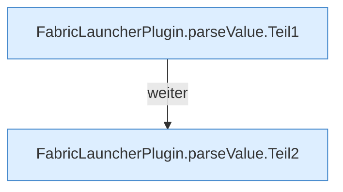

[[00 Start]] › [[Plugin-Kern]] › [[Properties]] › [[FabricLauncherPlugin.parseValue]]

# FabricLauncherPlugin.parseValue

`FabricLauncherPlugin.parseValue(String v)` [src/main/java/de/aichele/childlauncher/FabricLauncherPlugin.java:2603–2609](https://github.com/Sciddie/minecraft-serverhoster-plugin/blob/95b02b953b0b4c23673e900e021a7c3c844aa37d/src/main/java/de/aichele/childlauncher/FabricLauncherPlugin.java#L2603-L2609)



```knoten
FabricLauncherPlugin.parseValue.Teil1
  Abschnitt 1 dieses Ablaufs, in Quellreihenfolge.
FabricLauncherPlugin.parseValue.Teil2
  Abschnitt 2 dieses Ablaufs, in Quellreihenfolge.
```

- `parseValue` in `src/main/java/de/aichele/childlauncher/FabricLauncherPlugin.java`
