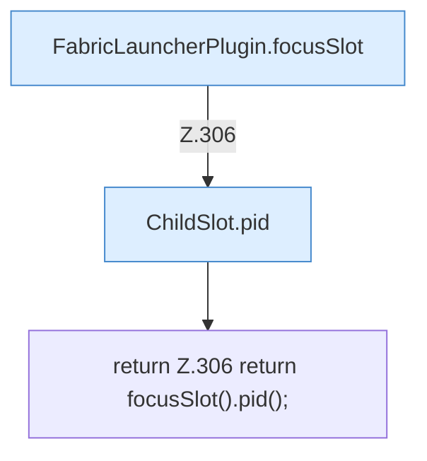

[[00 Start]] › [[Plugin-Kern]] › [[Slot-Status]] › [[FabricLauncherPlugin.pid()]]

# FabricLauncherPlugin.pid()

`FabricLauncherPlugin.pid()` [src/main/java/de/aichele/childlauncher/FabricLauncherPlugin.java:306–306](https://github.com/Sciddie/minecraft-serverhoster-plugin/blob/95b02b953b0b4c23673e900e021a7c3c844aa37d/src/main/java/de/aichele/childlauncher/FabricLauncherPlugin.java#L306-L306)



```knoten
FabricLauncherPlugin.focusSlot
  Liefert oder setzt den Fokus `focusSlot`. Ruft `slot`.
ChildSlot.pid
  Liefert die Prozessnummer `pid`.
return Z.306 return focusSlot().pid();
  Zeile 306: Rückgabe `return focusSlot().pid();`.
```

- `pid` in `src/main/java/de/aichele/childlauncher/FabricLauncherPlugin.java`
- Befund: toter Code, prüfen. src/main/java/de/aichele/childlauncher/FabricLauncherPlugin.java:306–306 kein Produktionsaufruf im Aufrufgraph; Name kommt in UI, Config oder anderem Text vor
