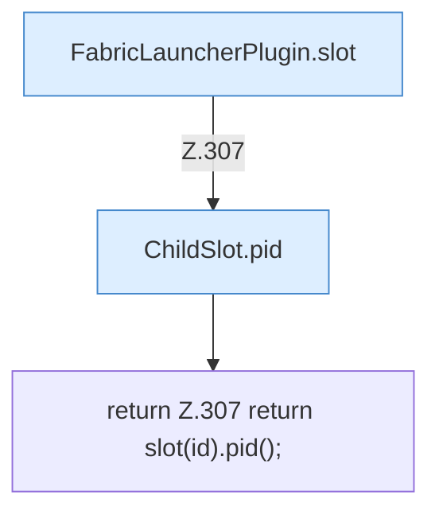

[[00 Start]] › [[Plugin-Kern]] › [[Slot-Status]] › [[FabricLauncherPlugin.pid(String)]]

# FabricLauncherPlugin.pid(String)

`FabricLauncherPlugin.pid(String id)` [src/main/java/de/aichele/childlauncher/FabricLauncherPlugin.java:307–307](https://github.com/Sciddie/minecraft-serverhoster-plugin/blob/95b02b953b0b4c23673e900e021a7c3c844aa37d/src/main/java/de/aichele/childlauncher/FabricLauncherPlugin.java#L307-L307)



```knoten
FabricLauncherPlugin.slot
  `slot` in `FabricLauncherPlugin.java`. Ruft `profile`, `ChildSlot`.
ChildSlot.pid
  Liefert die Prozessnummer `pid`.
return Z.307 return slot(id).pid();
  Zeile 307: Rückgabe `return slot(id).pid();`.
```

- `pid` in `src/main/java/de/aichele/childlauncher/FabricLauncherPlugin.java`
- Befund: toter Code, prüfen. src/main/java/de/aichele/childlauncher/FabricLauncherPlugin.java:307–307 kein Produktionsaufruf im Aufrufgraph; Name kommt in UI, Config oder anderem Text vor
