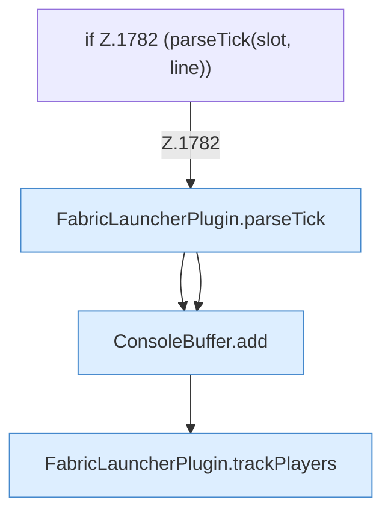

[[00 Start]] › [[Child-Prozess]] › [[Pipe-Watch]] › [[FabricLauncherPlugin.pipe]] › [[FabricLauncherPlugin.pipe.Z1778.Z1780.Teil1]]

# FabricLauncherPlugin.pipe.Z1778.Z1780.Teil1



```knoten
if Z.1782 (parseTick(slot, line))
  Zeile 1782: prüft `(parseTick(slot, line))`.
FabricLauncherPlugin.parseTick
  Wertet aus `parseTick`. Ruft `consume`, `pushMspt`.
ConsoleBuffer.add
  Fügt hinzu `add`.
FabricLauncherPlugin.trackPlayers
  Führt mit `trackPlayers`.
```

- Fortsetzung von `FabricLauncherPlugin.pipe.Z1778.Z1780`, Quellreihenfolge.
