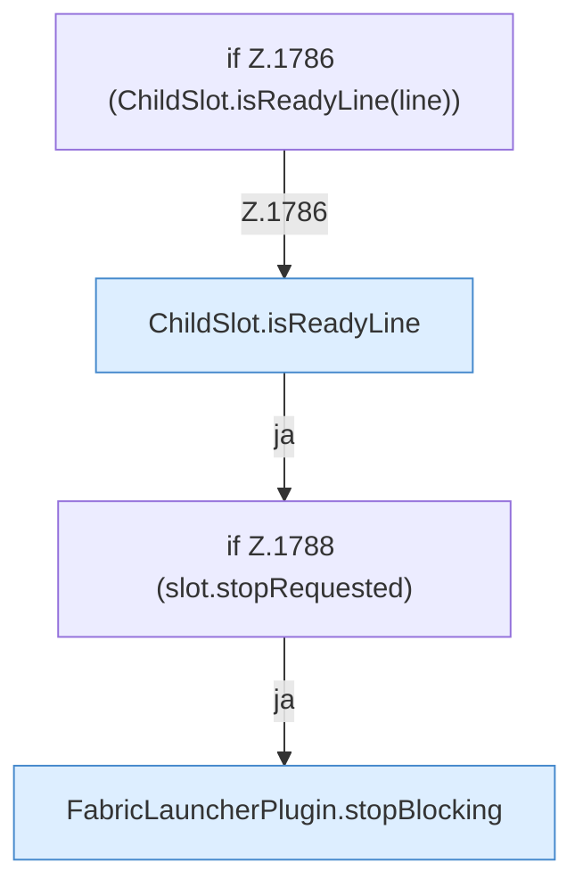

[[00 Start]] › [[Child-Prozess]] › [[Pipe-Watch]] › [[FabricLauncherPlugin.pipe]] › [[FabricLauncherPlugin.pipe.Z1778.Z1780.Teil2]]

# FabricLauncherPlugin.pipe.Z1778.Z1780.Teil2



```knoten
if Z.1786 (ChildSlot.isReadyLine(line))
  Zeile 1786: prüft `(ChildSlot.isReadyLine(line))`.
ChildSlot.isReadyLine
  Dieser Teil prüft eine [[Glossar#Zeile|Zeile]]. Prüft `isReadyLine`.
if Z.1788 (slot.stopRequested)
  Zeile 1788: prüft `(slot.stopRequested)`.
FabricLauncherPlugin.stopBlocking
  Setzt den Zustand auf „stoppt“ und wartet, bis der [[Glossar#Spielserver|Spielserver]] wirklich aus ist. Stoppt `stopBlocking`. Ruft `invalidateRestarts`, `running`, `stopProcess`.
```

> [!knoten]- Was die Blöcke tun
> - **if Z.1786 (ChildSlot.isReadyLine(line))**: Zeile 1786: prüft `(ChildSlot.isReadyLine(line))`.
> - **ChildSlot.isReadyLine**: Dieser Teil prüft eine [[Glossar#Zeile|Zeile]]. Prüft `isReadyLine`.
> - **if Z.1788 (slot.stopRequested)**: Zeile 1788: prüft `(slot.stopRequested)`.
> - **FabricLauncherPlugin.stopBlocking**: Setzt den Zustand auf „stoppt“ und wartet, bis der [[Glossar#Spielserver|Spielserver]] wirklich aus ist. Stoppt `stopBlocking`. Ruft `invalidateRestarts`, `running`, `stopProcess`.

- Ein weiterer Abschnitt derselben Übersicht.
- Fortsetzung von `FabricLauncherPlugin.pipe.Z1778.Z1780`.
