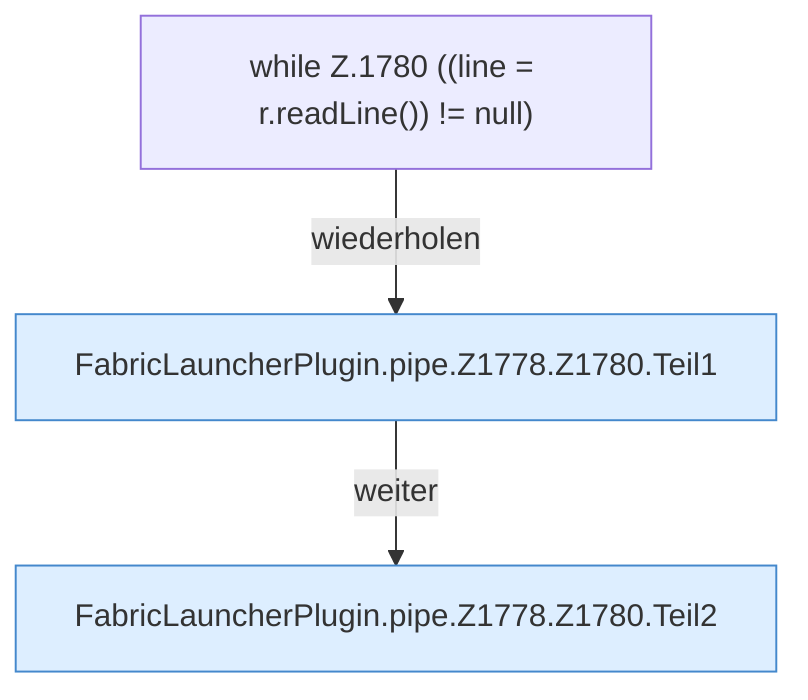

[[00 Start]] › [[Child-Prozess]] › [[Pipe-Watch]] › [[FabricLauncherPlugin.pipe]] › [[FabricLauncherPlugin.pipe.Z1778.Z1780]]

# FabricLauncherPlugin.pipe.Z1778.Z1780

- Fortsetzung von `FabricLauncherPlugin.pipe.Z1778`, Quellreihenfolge.
