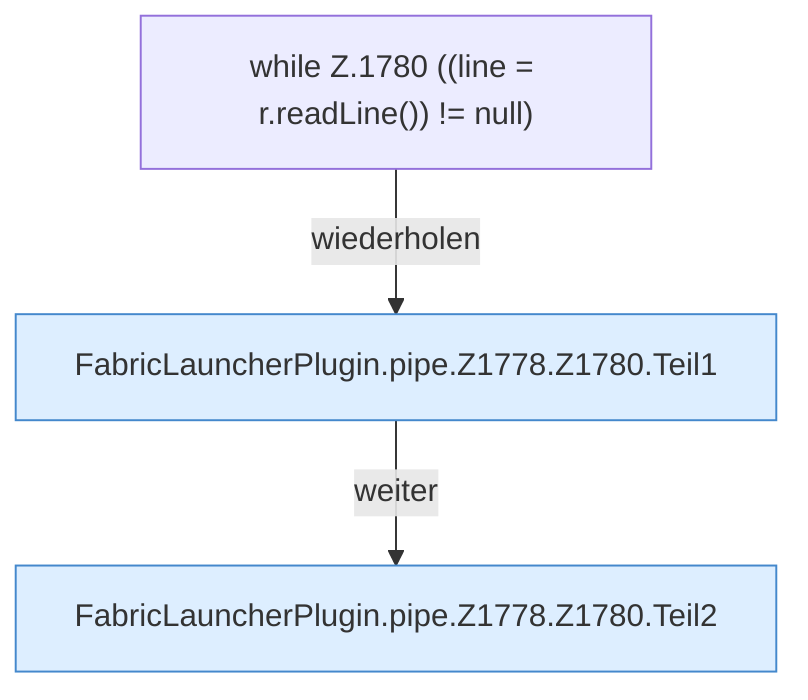

[[00 Start]] › [[Child-Prozess]] › [[Pipe-Watch]] › [[FabricLauncherPlugin.pipe]] › [[FabricLauncherPlugin.pipe.Z1778.Z1780]]

# FabricLauncherPlugin.pipe.Z1778.Z1780



```knoten
while Z.1780 ((line = r.readLine()) != null)
  Zeile 1780: Schleife `((line = r.readLine()) != null)`.
FabricLauncherPlugin.pipe.Z1778.Z1780.Teil1
  Ein weiterer Abschnitt derselben Übersicht. Abschnitt 1 dieses Ablaufs, in Quellreihenfolge.
FabricLauncherPlugin.pipe.Z1778.Z1780.Teil2
  Ein weiterer Abschnitt derselben Übersicht. Abschnitt 2 dieses Ablaufs, in Quellreihenfolge.
```

> [!knoten]- Was die Blöcke tun
> - **while Z.1780 ((line = r.readLine()) != null)**: Zeile 1780: Schleife `((line = r.readLine()) != null)`.
> - **FabricLauncherPlugin.pipe.Z1778.Z1780.Teil1**: Ein weiterer Abschnitt derselben Übersicht. Abschnitt 1 dieses Ablaufs, in Quellreihenfolge.
> - **FabricLauncherPlugin.pipe.Z1778.Z1780.Teil2**: Ein weiterer Abschnitt derselben Übersicht. Abschnitt 2 dieses Ablaufs, in Quellreihenfolge.

- Der Ablauf geht in [[Glossar#Zeile|Zeile]] 1780 weiter. Eine Ebene tiefer steht er genauer.
- Fortsetzung von `FabricLauncherPlugin.pipe.Z1778`.
