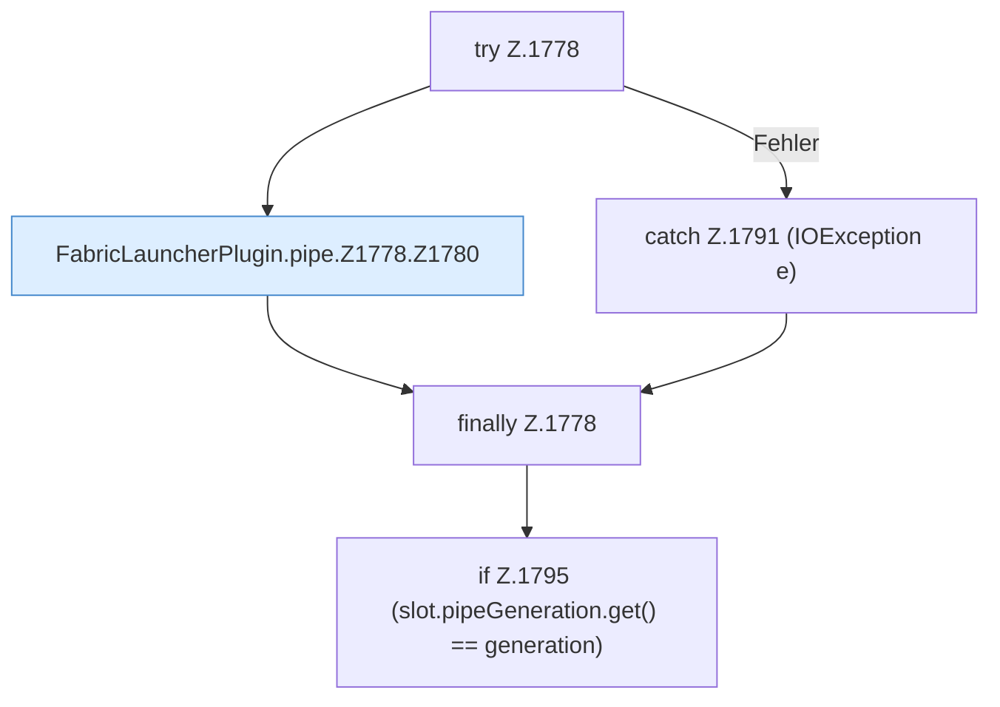

[[00 Start]] › [[Child-Prozess]] › [[Pipe-Watch]] › [[FabricLauncherPlugin.pipe]] › [[FabricLauncherPlugin.pipe.Z1778]]

# FabricLauncherPlugin.pipe.Z1778



```knoten
try Z.1778
  Zeile 1778: Versuch. Der Fehlerpfad geht in catch.
FabricLauncherPlugin.pipe.Z1778.Z1780
  Der Ablauf geht in [[Glossar#Zeile|Zeile]] 1780 weiter. Eine Ebene tiefer steht er genauer. Fortsetzung des Ablaufs ab Zeile 1780.
catch Z.1791 (IOException e)
  Zeile 1791: fängt (IOException e).
finally Z.1778
  Läuft danach immer, auch nach einem Fehler.
if Z.1795 (slot.pipeGeneration.get() == generation)
  Zeile 1795: prüft `(slot.pipeGeneration.get() == generation)`.
```

> [!knoten]- Was die Blöcke tun
> - **try Z.1778**: Zeile 1778: Versuch. Der Fehlerpfad geht in catch.
> - **FabricLauncherPlugin.pipe.Z1778.Z1780**: Der Ablauf geht in [[Glossar#Zeile|Zeile]] 1780 weiter. Eine Ebene tiefer steht er genauer. Fortsetzung des Ablaufs ab Zeile 1780.
> - **catch Z.1791 (IOException e)**: Zeile 1791: fängt (IOException e).
> - **finally Z.1778**: Läuft danach immer, auch nach einem Fehler.
> - **if Z.1795 (slot.pipeGeneration.get() == generation)**: Zeile 1795: prüft `(slot.pipeGeneration.get() == generation)`.

- Der Ablauf geht in [[Glossar#Zeile|Zeile]] 1778 weiter. Eine Ebene tiefer steht er genauer.
- Fortsetzung von `FabricLauncherPlugin.pipe`.
