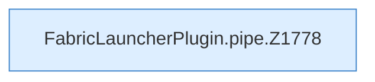

[[00 Start]] › [[Child-Prozess]] › [[Pipe-Watch]] › [[FabricLauncherPlugin.pipe]]

# FabricLauncherPlugin.pipe

`FabricLauncherPlugin.pipe(ChildSlot slot, Process p, String prefix, int generation)` [src/main/java/de/aichele/childlauncher/FabricLauncherPlugin.java:1777–1797](https://github.com/Sciddie/minecraft-serverhoster-plugin/blob/95b02b953b0b4c23673e900e021a7c3c844aa37d/src/main/java/de/aichele/childlauncher/FabricLauncherPlugin.java#L1777-L1797)



```knoten
FabricLauncherPlugin.pipe.Z1778
  Der Ablauf geht in [[Glossar#Zeile|Zeile]] 1778 weiter. Eine Ebene tiefer steht er genauer. Im [[Glossar#Quelltext|Quelltext]] heißt das `Z1778`.
```

> [!knoten]- Was die Blöcke tun
> - **FabricLauncherPlugin.pipe.Z1778**: Der Ablauf geht in [[Glossar#Zeile|Zeile]] 1778 weiter. Eine Ebene tiefer steht er genauer. Im [[Glossar#Quelltext|Quelltext]] heißt das `Z1778`.

- Liest die [[Glossar#Konsole|Konsole]] [[Glossar#Zeile|Zeile]] für Zeile mit, bis das Programm endet.
