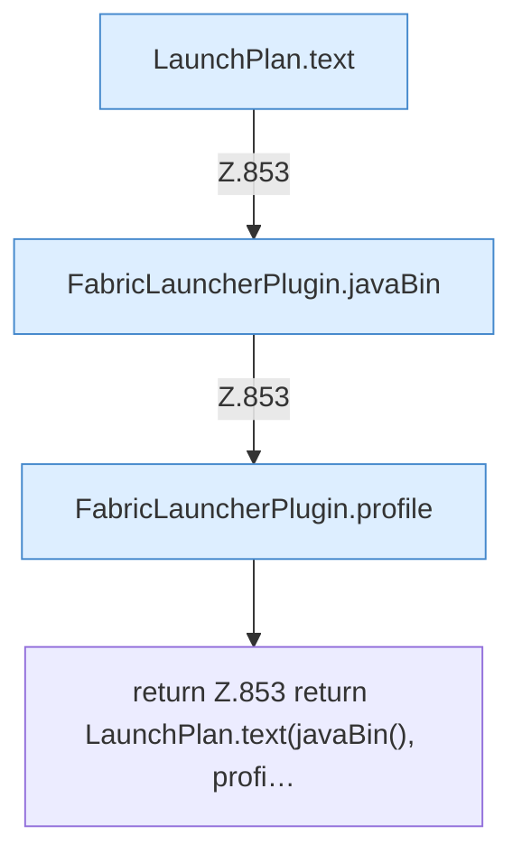

[[00 Start]] › [[Plugin-Kern]] › [[Diagnose]] › [[FabricLauncherPlugin.planText]]

# FabricLauncherPlugin.planText

`FabricLauncherPlugin.planText(String id)` [src/main/java/de/aichele/childlauncher/FabricLauncherPlugin.java:853–853](https://github.com/Sciddie/minecraft-serverhoster-plugin/blob/95b02b953b0b4c23673e900e021a7c3c844aa37d/src/main/java/de/aichele/childlauncher/FabricLauncherPlugin.java#L853-L853)



```knoten
LaunchPlan.text
  Dieser Teil macht hier einen einzelnen Schritt. Eine Ebene tiefer steht er genauer. Im [[Glossar#Quelltext|Quelltext]] heißt das `text`.
FabricLauncherPlugin.javaBin
  Liefert das Java-Programm, mit dem der [[Glossar#Spielserver|Spielserver]] gestartet wird. Im [[Glossar#Quelltext|Quelltext]] heißt das `javaBin`.
FabricLauncherPlugin.profile
  Das [[Glossar#Plugin|Plugin]] macht hier einen einzelnen Schritt. Eine Ebene tiefer steht er genauer. Im [[Glossar#Quelltext|Quelltext]] heißt das `profile`.
return Z.853 return LaunchPlan.text(javaBin(), profi…
  Hier endet die [[Glossar#Funktion|Funktion]] und liefert ein Ergebnis zurück. Das steht in [[Glossar#Zeile|Zeile]] 853.
```

> [!knoten]- Was die Blöcke tun
> - **LaunchPlan.text**: Dieser Teil macht hier einen einzelnen Schritt. Eine Ebene tiefer steht er genauer. Im [[Glossar#Quelltext|Quelltext]] heißt das `text`.
> - **FabricLauncherPlugin.javaBin**: Liefert das Java-Programm, mit dem der [[Glossar#Spielserver|Spielserver]] gestartet wird. Im [[Glossar#Quelltext|Quelltext]] heißt das `javaBin`.
> - **FabricLauncherPlugin.profile**: Das [[Glossar#Plugin|Plugin]] macht hier einen einzelnen Schritt. Eine Ebene tiefer steht er genauer. Im [[Glossar#Quelltext|Quelltext]] heißt das `profile`.
> - **return Z.853 return LaunchPlan.text(javaBin(), profi…**: Hier endet die [[Glossar#Funktion|Funktion]] und liefert ein Ergebnis zurück. Das steht in [[Glossar#Zeile|Zeile]] 853.

- Schreibt den [[Glossar#Startplan|Startplan]] als lesbaren Text.
