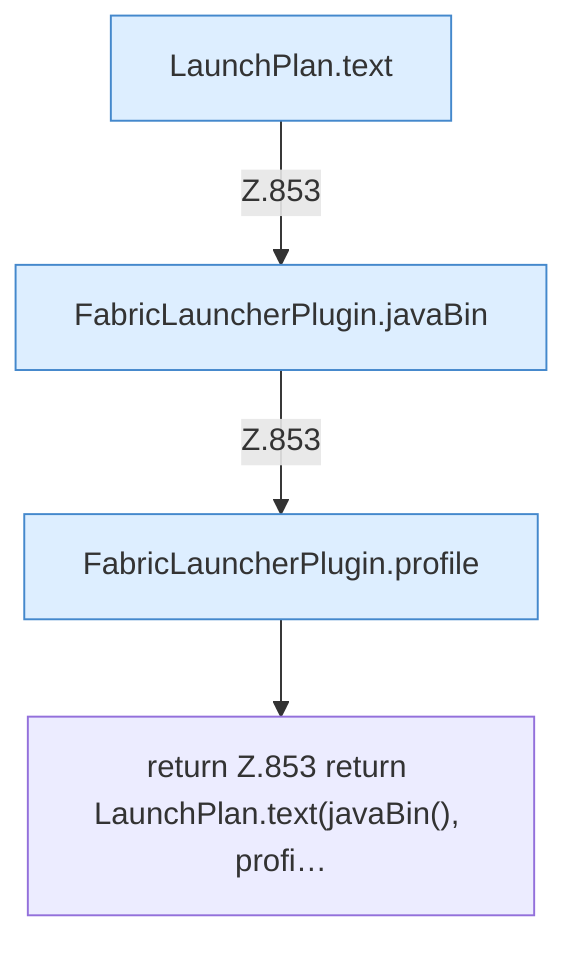

[[00 Start]] › [[Plugin-Kern]] › [[Diagnose]] › [[FabricLauncherPlugin.planText]]

# FabricLauncherPlugin.planText

`FabricLauncherPlugin.planText(String id)` [src/main/java/de/aichele/childlauncher/FabricLauncherPlugin.java:853–853](https://github.com/Sciddie/minecraft-serverhoster-plugin/blob/95b02b953b0b4c23673e900e021a7c3c844aa37d/src/main/java/de/aichele/childlauncher/FabricLauncherPlugin.java#L853-L853)



```knoten
LaunchPlan.text
  Antwortet mit Text `text`. Ruft `argv`.
FabricLauncherPlugin.javaBin
  Liefert das Java-Binary `javaBin`. Ruft `isWindows`.
FabricLauncherPlugin.profile
  `profile` in `FabricLauncherPlugin.java`.
return Z.853 return LaunchPlan.text(javaBin(), profi…
  Zeile 853: Rückgabe `return LaunchPlan.text(javaBin(), profi…`.
```

- `planText` in `src/main/java/de/aichele/childlauncher/FabricLauncherPlugin.java`
