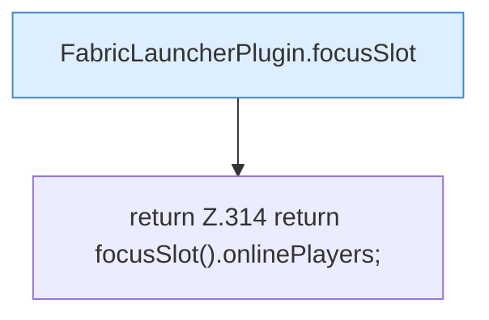

[[00 Start]] › [[Plugin-Kern]] › [[Slot-Status]] › [[FabricLauncherPlugin.players()]]

# FabricLauncherPlugin.players()

`FabricLauncherPlugin.players()` [src/main/java/de/aichele/childlauncher/FabricLauncherPlugin.java:314–314](https://github.com/Sciddie/minecraft-serverhoster-plugin/blob/95b02b953b0b4c23673e900e021a7c3c844aa37d/src/main/java/de/aichele/childlauncher/FabricLauncherPlugin.java#L314-L314)



```knoten
FabricLauncherPlugin.focusSlot
  Das [[Glossar#Plugin|Plugin]] liefert den [[Glossar#Platz|Platz]]. Im [[Glossar#Quelltext|Quelltext]] heißt das `focusSlot`.
return Z.314 return focusSlot().onlinePlayers;
  Hier endet die [[Glossar#Funktion|Funktion]] und liefert ein Ergebnis zurück. Das steht in [[Glossar#Zeile|Zeile]] 314.
```

> [!knoten]- Was die Blöcke tun
> - **FabricLauncherPlugin.focusSlot**: Das [[Glossar#Plugin|Plugin]] liefert den [[Glossar#Platz|Platz]]. Im [[Glossar#Quelltext|Quelltext]] heißt das `focusSlot`.
> - **return Z.314 return focusSlot().onlinePlayers;**: Hier endet die [[Glossar#Funktion|Funktion]] und liefert ein Ergebnis zurück. Das steht in [[Glossar#Zeile|Zeile]] 314.

- Liefert die [[Glossar#Spieler|Spieler]], die gerade online sind.
- Auffällig: im normalen Betrieb ruft das niemand auf. Das nennt man [[Glossar#Ungenutzt|Ungenutzt]].
