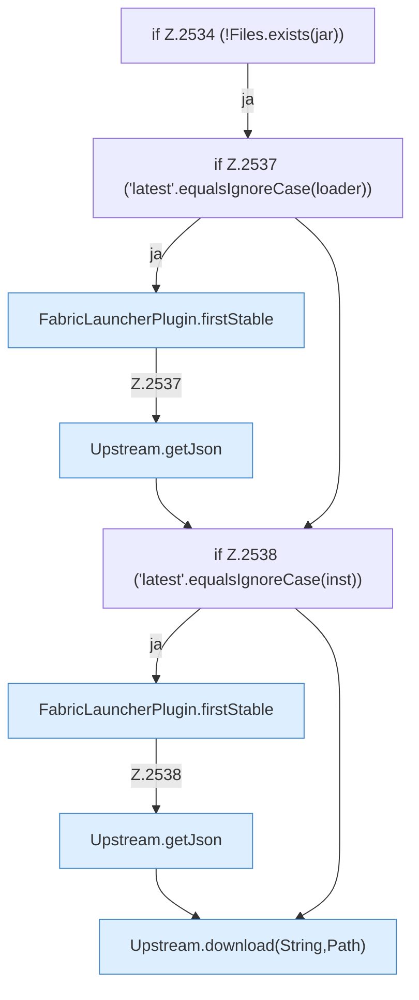

[[00 Start]] › [[Plugin-Kern]] › [[Properties]] › [[FabricLauncherPlugin.prepareFiles]] › [[FabricLauncherPlugin.prepareFiles.Z2531.Case2532.Z2534]]

# FabricLauncherPlugin.prepareFiles.Z2531.Case2532.Z2534



```knoten
if Z.2534 (!Files.exists(jar))
  Zeile 2534: prüft `(!Files.exists(jar))`.
if Z.2537 ('latest'.equalsIgnoreCase(loader))
  Zeile 2537: prüft `('latest'.equalsIgnoreCase(loader))`.
FabricLauncherPlugin.firstStable
  `firstStable` in `FabricLauncherPlugin.java`.
Upstream.getJson
  Liefert `getJson`.
if Z.2538 ('latest'.equalsIgnoreCase(inst))
  Zeile 2538: prüft `('latest'.equalsIgnoreCase(inst))`.
Upstream.download(String,Path)
  Liefert zum Herunterladen `download`. Ruft `download`.
```

- Fortsetzung von `FabricLauncherPlugin.prepareFiles.Z2531.Case2532`, Quellreihenfolge.
