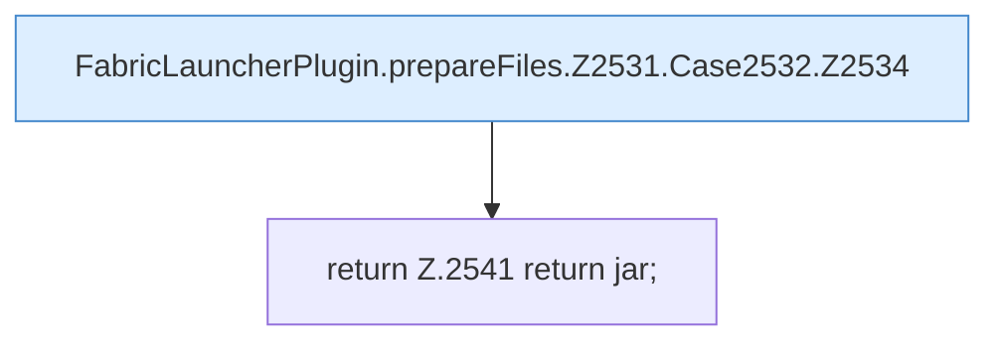

[[00 Start]] › [[Plugin-Kern]] › [[Properties]] › [[FabricLauncherPlugin.prepareFiles]] › [[FabricLauncherPlugin.prepareFiles.Z2531.Case2532]]

# FabricLauncherPlugin.prepareFiles.Z2531.Case2532



```knoten
FabricLauncherPlugin.prepareFiles.Z2531.Case2532.Z2534
  Fortsetzung des Ablaufs ab Zeile 2534.
return Z.2541 return jar;
  Zeile 2541: Rückgabe `return jar;`.
```

- Fortsetzung von `FabricLauncherPlugin.prepareFiles.Z2531`, Quellreihenfolge.
