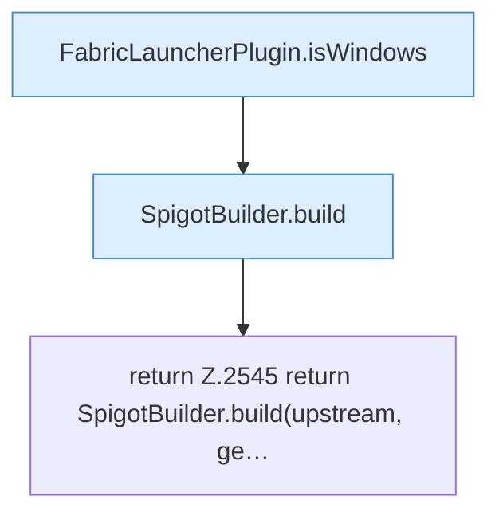

[[00 Start]] › [[Plugin-Kern]] › [[Properties]] › [[FabricLauncherPlugin.prepareFiles]] › [[FabricLauncherPlugin.prepareFiles.Z2531.Case2543]]

# FabricLauncherPlugin.prepareFiles.Z2531.Case2543



```knoten
FabricLauncherPlugin.isWindows
  Das [[Glossar#Plugin|Plugin]] prüft Windows. Prüft `isWindows`.
SpigotBuilder.build
  Dieser Teil baut das. Baut `build`. Ruft `assertRev`, `download`, `commandExists`.
return Z.2545 return SpigotBuilder.build(upstream, ge…
  Zeile 2545: Rückgabe `return SpigotBuilder.build(upstream, ge…`.
```

> [!knoten]- Was die Blöcke tun
> - **FabricLauncherPlugin.isWindows**: Das [[Glossar#Plugin|Plugin]] prüft Windows. Prüft `isWindows`.
> - **SpigotBuilder.build**: Dieser Teil baut das. Baut `build`. Ruft `assertRev`, `download`, `commandExists`.
> - **return Z.2545 return SpigotBuilder.build(upstream, ge…**: Zeile 2545: Rückgabe `return SpigotBuilder.build(upstream, ge…`.

- Das Innere eines Wegs, ab [[Glossar#Zeile|Zeile]] 2543.
- Fortsetzung von `FabricLauncherPlugin.prepareFiles.Z2531`.
