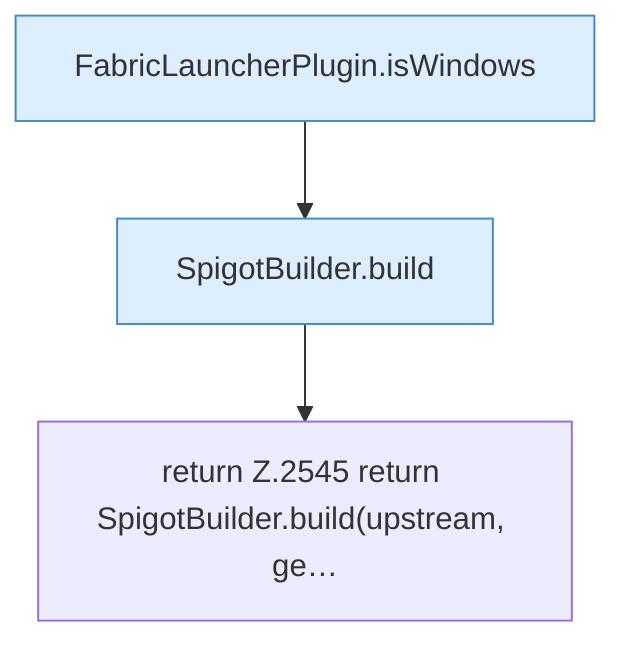

[[00 Start]] › [[Plugin-Kern]] › [[Properties]] › [[FabricLauncherPlugin.prepareFiles]] › [[FabricLauncherPlugin.prepareFiles.Z2531.Case2543]]

# FabricLauncherPlugin.prepareFiles.Z2531.Case2543



```knoten
FabricLauncherPlugin.isWindows
  Prüft `isWindows`.
SpigotBuilder.build
  Baut `build`. Ruft `assertRev`, `download`, `commandExists`.
return Z.2545 return SpigotBuilder.build(upstream, ge…
  Zeile 2545: Rückgabe `return SpigotBuilder.build(upstream, ge…`.
```

- Fortsetzung von `FabricLauncherPlugin.prepareFiles.Z2531`, Quellreihenfolge.
