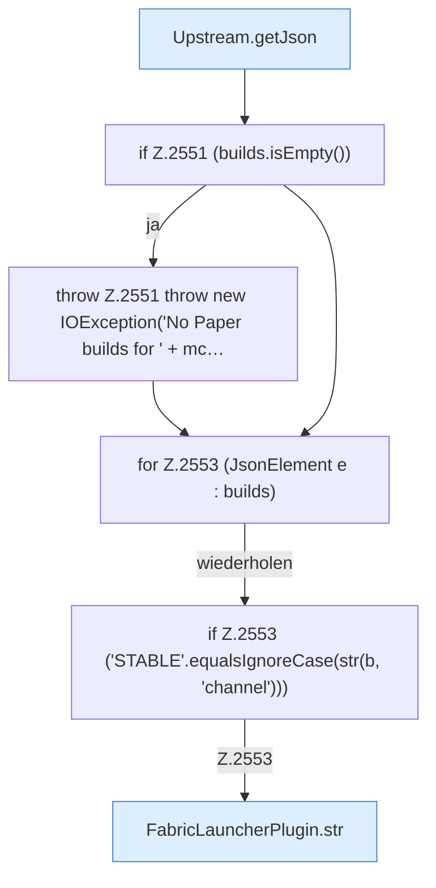

[[00 Start]] › [[Plugin-Kern]] › [[Properties]] › [[FabricLauncherPlugin.prepareFiles]] › [[FabricLauncherPlugin.prepareFiles.Z2531.Case2547.Z2549.Teil1]]

# FabricLauncherPlugin.prepareFiles.Z2531.Case2547.Z2549.Teil1



```knoten
Upstream.getJson
  Liefert `getJson`.
if Z.2551 (builds.isEmpty())
  Zeile 2551: prüft `(builds.isEmpty())`.
throw Z.2551 throw new IOException('No Paper builds for ' + mc…
  Zeile 2551: Abbruch `throw new IOException('No Paper builds for ' + mc…`.
for Z.2553 (JsonElement e : builds)
  Zeile 2553: Schleife `(JsonElement e : builds)`.
if Z.2553 ('STABLE'.equalsIgnoreCase(str(b, 'channel')))
  Zeile 2553: prüft `('STABLE'.equalsIgnoreCase(str(b, 'channel')))`.
FabricLauncherPlugin.str
  `str` in `FabricLauncherPlugin.java`.
```

- Fortsetzung von `FabricLauncherPlugin.prepareFiles.Z2531.Case2547.Z2549`, Quellreihenfolge.
