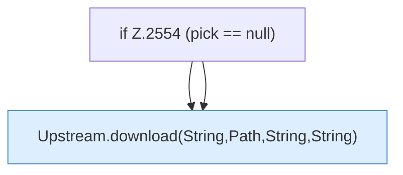

[[00 Start]] › [[Plugin-Kern]] › [[Properties]] › [[FabricLauncherPlugin.prepareFiles]] › [[FabricLauncherPlugin.prepareFiles.Z2531.Case2547.Z2549.Teil2]]

# FabricLauncherPlugin.prepareFiles.Z2531.Case2547.Z2549.Teil2



```knoten
if Z.2554 (pick == null)
  Zeile 2554: prüft `(pick == null)`.
Upstream.download(String,Path,String,String)
  Dieser Teil holt das. Liefert zum Herunterladen `download`. Ruft `checkHash`.
```

> [!knoten]- Was die Blöcke tun
> - **if Z.2554 (pick == null)**: Zeile 2554: prüft `(pick == null)`.
> - **Upstream.download(String,Path,String,String)**: Dieser Teil holt das. Liefert zum Herunterladen `download`. Ruft `checkHash`.

- Ein weiterer Abschnitt derselben Übersicht.
- Fortsetzung von `FabricLauncherPlugin.prepareFiles.Z2531.Case2547.Z2549`.
