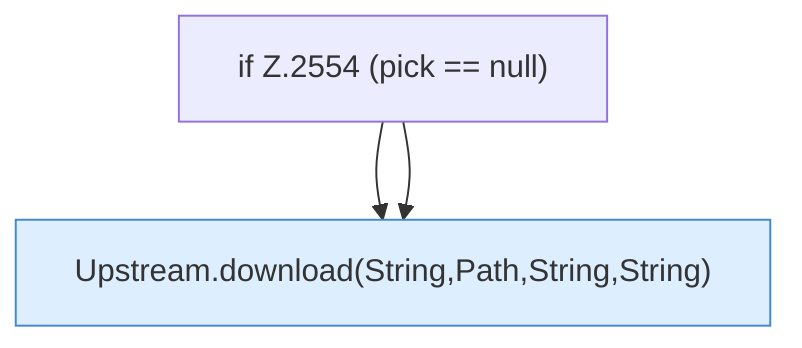

[[00 Start]] › [[Plugin-Kern]] › [[Properties]] › [[FabricLauncherPlugin.prepareFiles]] › [[FabricLauncherPlugin.prepareFiles.Z2531.Case2547.Z2549.Teil2]]

# FabricLauncherPlugin.prepareFiles.Z2531.Case2547.Z2549.Teil2

- Fortsetzung von `FabricLauncherPlugin.prepareFiles.Z2531.Case2547.Z2549`, Quellreihenfolge.
