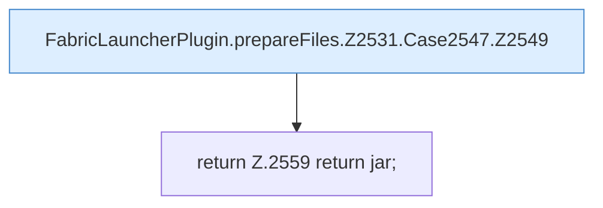

[[00 Start]] › [[Plugin-Kern]] › [[Properties]] › [[FabricLauncherPlugin.prepareFiles]] › [[FabricLauncherPlugin.prepareFiles.Z2531.Case2547]]

# FabricLauncherPlugin.prepareFiles.Z2531.Case2547

- Fortsetzung von `FabricLauncherPlugin.prepareFiles.Z2531`, Quellreihenfolge.
